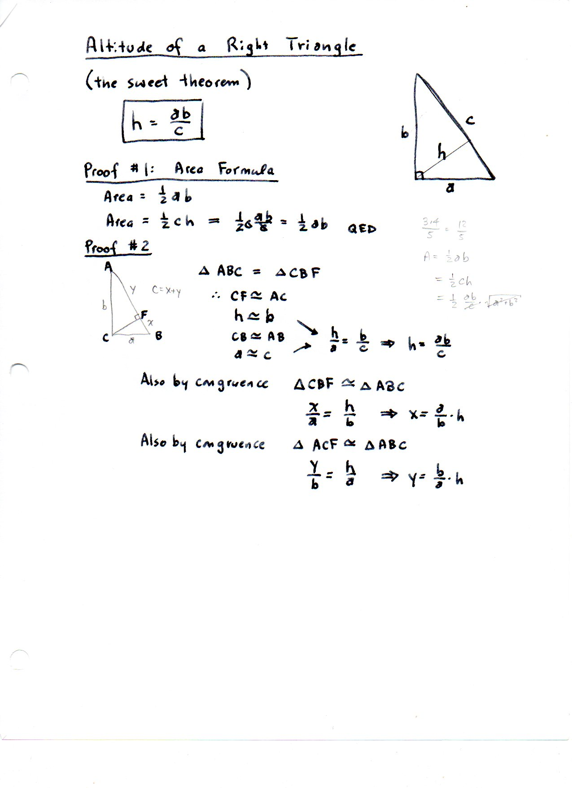
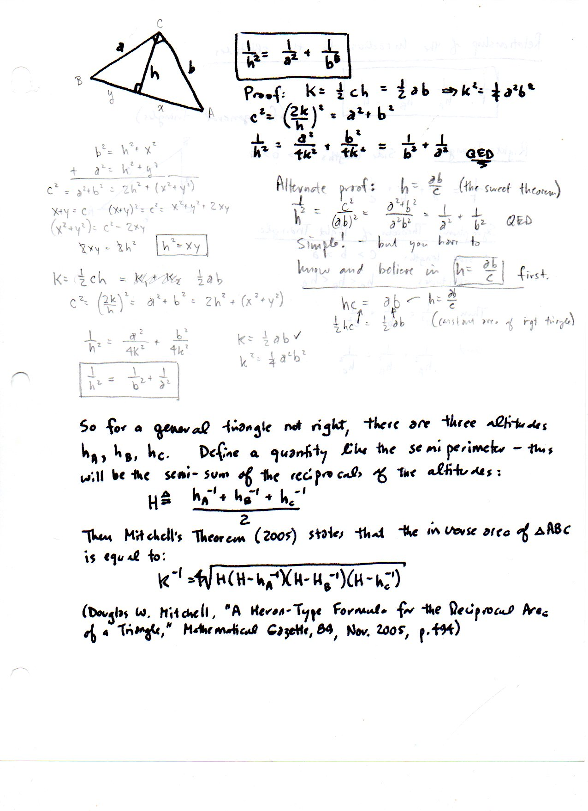
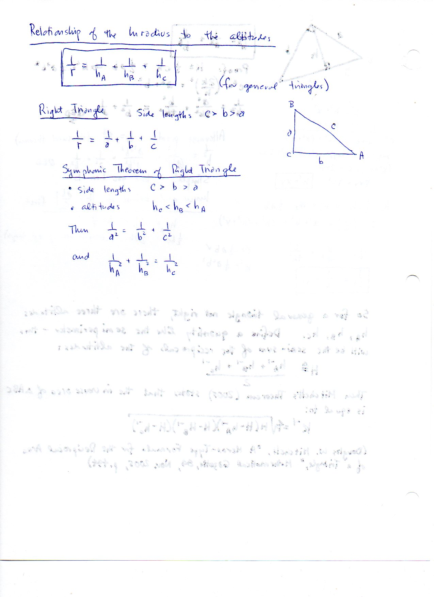
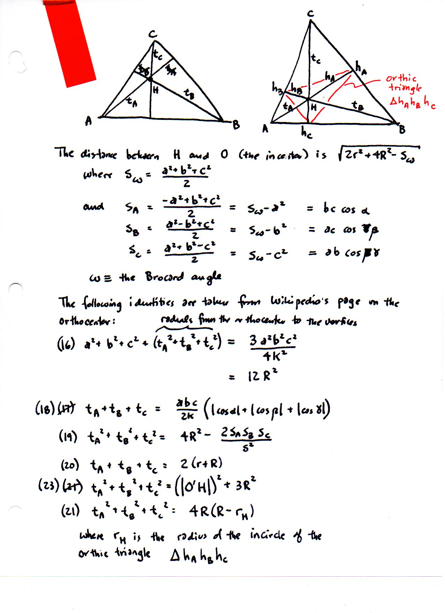

=======================================================================================
F.50 Altitudes, Mitchell's Reciprocal Heron Formula, and the Symphonic Theorem — Folios
=======================================================================================

Archival manuscript scans and diplomatic transcriptions from :person:`seelig`'s
notebooks for **F.50 (Altitudes, Mitchell's Reciprocal Heron Formula, and the Symphonic Theorem)** (:cite:`SeeligNotebooks`).

Folio 0318 (Page 1 of 4): Altitude of a Right Triangle — 'The Sweet Theorem' (altitude-right-001)
-------------------------------------------------------------------------------------------------

.. folio:: 0318

   Folio ``0318`` (original scan ``0318.jpg``) from ``resources/seelig/50_altitudes``.

**Diplomatic Mathematical & Geometric Transcription**

**Diplomatic Transcription — Folio 0318** (``0318.jpg``, Sheet 1 of 4):

Proves :math:`h = ab/c` and the Inverse Pythagorean Theorem :math:`h^{-2} = a^{-2} + b^{-2}`.

.. math::

   H = \frac{h_A^{-1} + h_B^{-1} + h_C^{-1}}{2}, \qquad \frac{1}{K} = 4\sqrt{H(H - h_A^{-1})(H - h_B^{-1})(H - h_C^{-1})}

.. admonition:: Editorial & Symbolic Notes

   Archival scan ``0318.jpg`` from Fred W. Seelig's notebook dossier on **F.50 Altitudes, Mitchell's Reciprocal Heron Formula, and the Symphonic Theorem** (Page 1 of 4). Companion OpenDocument worksheet(s): ``Altitudes``, ``Orthocenter``, ``Right Triangle``. Classical Euclidean foundations: :ref:`I.12`, :ref:`I.47`, :ref:`VI.8`. Kimberling *Encyclopedia of Triangle Centers* loci: :ref:`X(1)`, :ref:`X(3)`, :ref:`X(4)`.

Folio 0319 (Page 2 of 4): Mitchell's Reciprocal Heron Formula for Altitudes (altitudes-001)
-------------------------------------------------------------------------------------------

.. folio:: 0319

   Folio ``0319`` (original scan ``0319.jpg``) from ``resources/seelig/50_altitudes``.

**Diplomatic Mathematical & Geometric Transcription**

**Diplomatic Transcription — Folio 0319** (``0319.jpg``, Sheet 2 of 4):

Cites Douglas W. Mitchell (2005) to express :math:`K^{-1} = 4\sqrt{H(H-h_A^{-1})(H-h_B^{-1})(H-h_C^{-1})}` and reconstructs :math:`(a,b,c) = (2K/h_A, 2K/h_B, 2K/h_C)`.

.. math::

   \frac{1}{h_A^2} + \frac{1}{h_B^2} = \frac{1}{h_C^2} \quad (\gamma = 90^\circ), \qquad |AH| + |BH| + |CH| = 2(r + R)

.. admonition:: Editorial & Symbolic Notes

   Archival scan ``0319.jpg`` from Fred W. Seelig's notebook dossier on **F.50 Altitudes, Mitchell's Reciprocal Heron Formula, and the Symphonic Theorem** (Page 2 of 4). Companion OpenDocument worksheet(s): ``Altitudes``, ``Orthocenter``, ``Right Triangle``. Classical Euclidean foundations: :ref:`I.12`, :ref:`I.47`, :ref:`VI.8`. Kimberling *Encyclopedia of Triangle Centers* loci: :ref:`X(1)`, :ref:`X(3)`, :ref:`X(4)`.

Folio 0320 (Page 3 of 4): The Symphonic Theorem & Altitude Ratios (altitudes-002)
---------------------------------------------------------------------------------

.. folio:: 0320

   Folio ``0320`` (original scan ``0320.jpg``) from ``resources/seelig/50_altitudes``.

**Diplomatic Mathematical & Geometric Transcription**

**Diplomatic Transcription — Folio 0320** (``0320.jpg``, Sheet 3 of 4):

States the Symphonic Theorem :math:`h_A^{-2} + h_B^{-2} = h_C^{-2}` for right triangles and relates :math:`h_A : h_B : h_C = a^{-1} : b^{-1} : c^{-1}`.

.. math::

   H = \frac{h_A^{-1} + h_B^{-1} + h_C^{-1}}{2}, \qquad \frac{1}{K} = 4\sqrt{H(H - h_A^{-1})(H - h_B^{-1})(H - h_C^{-1})}

.. admonition:: Editorial & Symbolic Notes

   Archival scan ``0320.jpg`` from Fred W. Seelig's notebook dossier on **F.50 Altitudes, Mitchell's Reciprocal Heron Formula, and the Symphonic Theorem** (Page 3 of 4). Companion OpenDocument worksheet(s): ``Altitudes``, ``Orthocenter``, ``Right Triangle``. Classical Euclidean foundations: :ref:`I.12`, :ref:`I.47`, :ref:`VI.8`. Kimberling *Encyclopedia of Triangle Centers* loci: :ref:`X(1)`, :ref:`X(3)`, :ref:`X(4)`.

Folio 0321 (Page 4 of 4): Six Orthocenter Segment Identities in Conway Notation (altitudes-003)
-----------------------------------------------------------------------------------------------

.. folio:: 0321

   Folio ``0321`` (original scan ``0321.jpg``) from ``resources/seelig/50_altitudes``.

**Diplomatic Mathematical & Geometric Transcription**

**Diplomatic Transcription — Folio 0321** (``0321.jpg``, Sheet 4 of 4):

Records :math:`t_A + t_B + t_C = 2(r+R)` and five companion identities for the upper and lower orthocenter segments.

.. math::

   \frac{1}{h_A^2} + \frac{1}{h_B^2} = \frac{1}{h_C^2} \quad (\gamma = 90^\circ), \qquad |AH| + |BH| + |CH| = 2(r + R)

.. admonition:: Editorial & Symbolic Notes

   Archival scan ``0321.jpg`` from Fred W. Seelig's notebook dossier on **F.50 Altitudes, Mitchell's Reciprocal Heron Formula, and the Symphonic Theorem** (Page 4 of 4). Companion OpenDocument worksheet(s): ``Altitudes``, ``Orthocenter``, ``Right Triangle``. Classical Euclidean foundations: :ref:`I.12`, :ref:`I.47`, :ref:`VI.8`. Kimberling *Encyclopedia of Triangle Centers* loci: :ref:`X(1)`, :ref:`X(3)`, :ref:`X(4)`.
