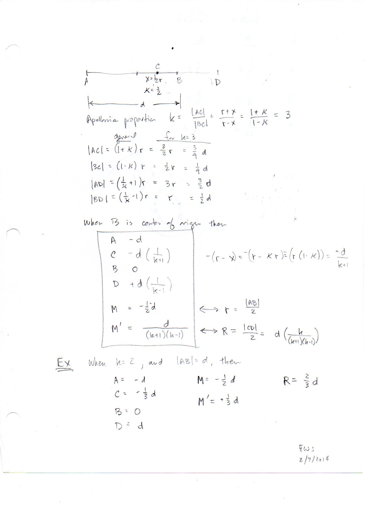
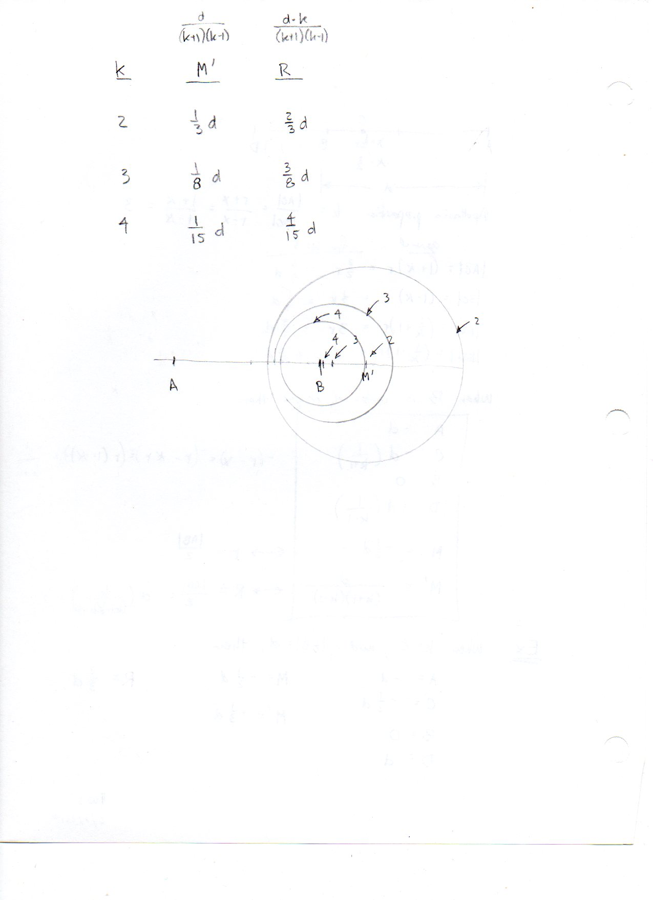
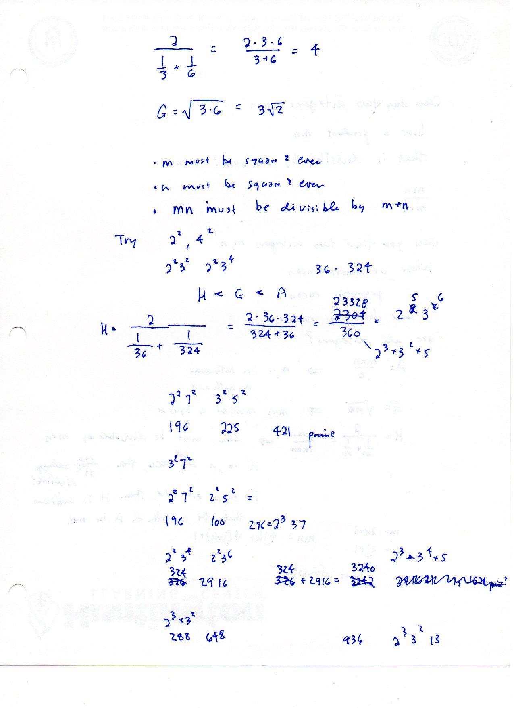
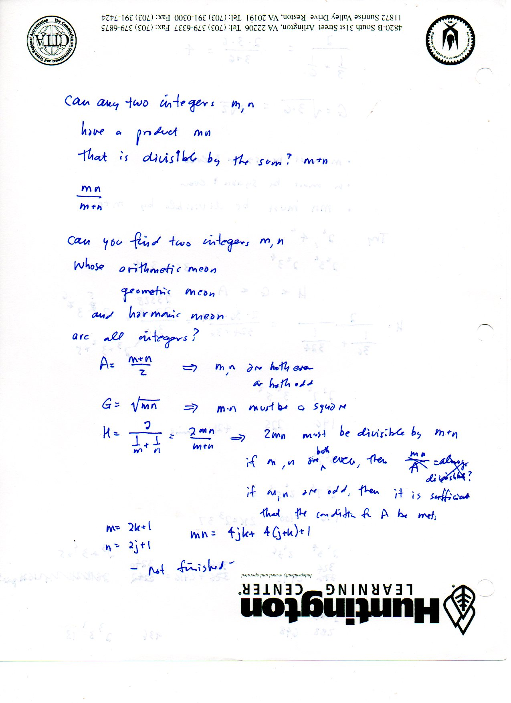
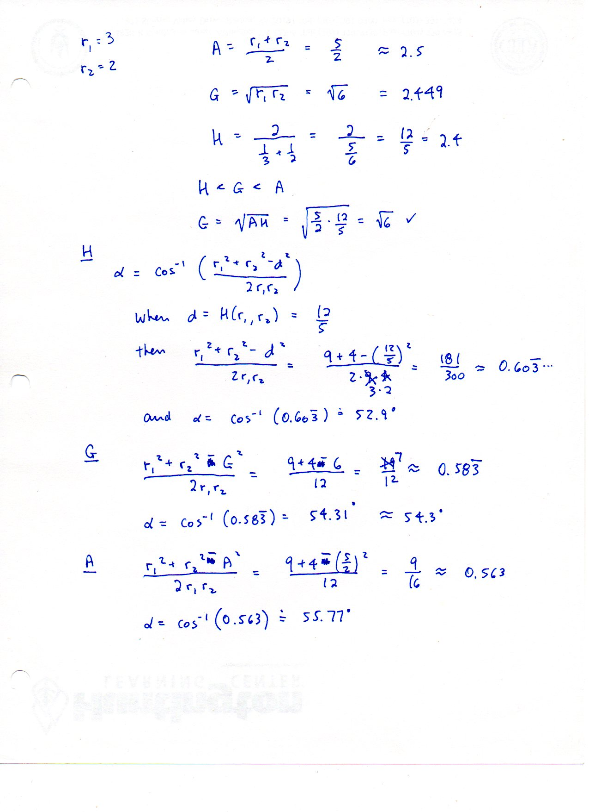
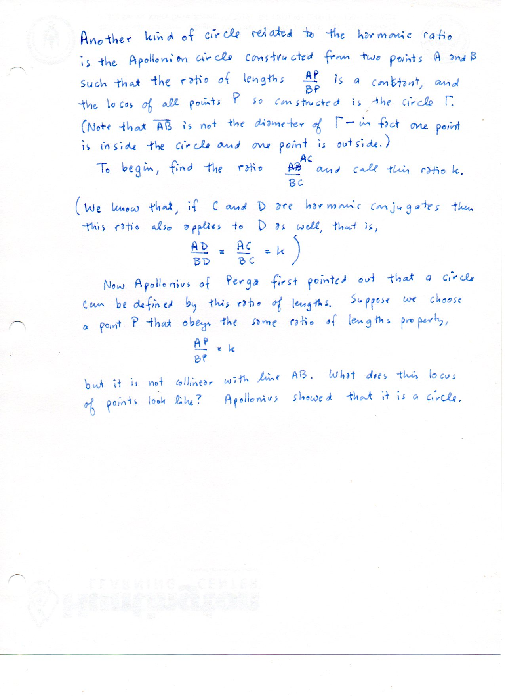
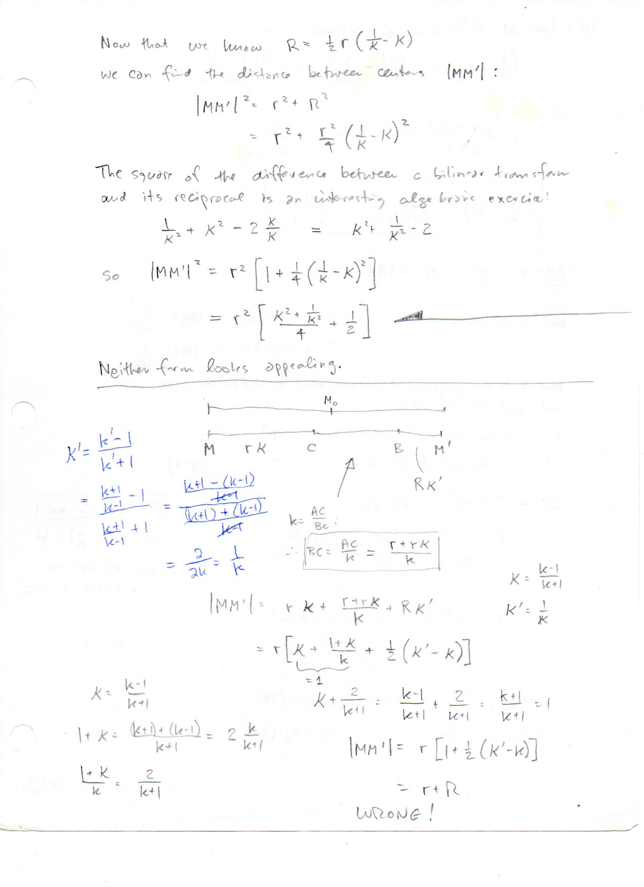
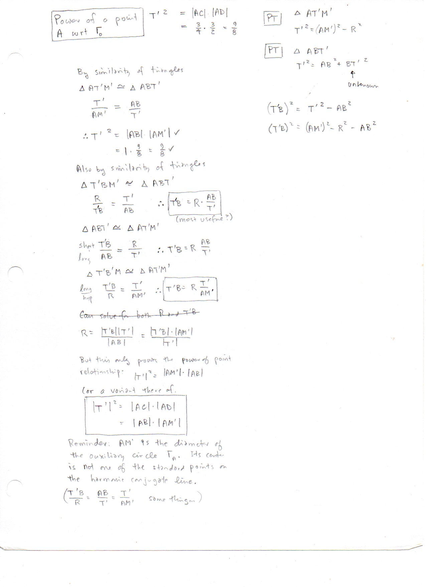
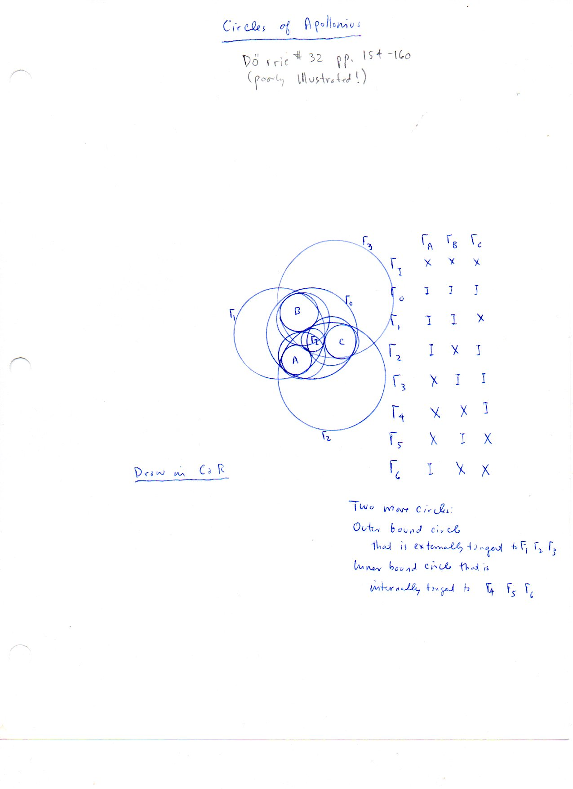

==============================================================
F.51 Apollonian Circles and the Problem of Apollonius — Folios
==============================================================

Archival manuscript scans and diplomatic transcriptions from :person:`seelig`'s
notebooks for **F.51 (Apollonian Circles and the Problem of Apollonius)** (:cite:`SeeligNotebooks`).

Folio 0322 (Page 1 of 9): Apollonian Circle Center M' & Radius R (apollonian-001, FWS 2/7/2014)
-----------------------------------------------------------------------------------------------

.. folio:: 0322

   Folio ``0322`` (original scan ``0322.jpg``) from ``resources/seelig/51_apollonian-circles``.

**Diplomatic Mathematical & Geometric Transcription**

**Diplomatic Transcription — Folio 0322** (``0322.jpg``, Sheet 1 of 9):

Derives :math:`|BC| = d/(k+1), |BD| = d/(k-1), M' = d/(k^2-1)`, and :math:`R = dk/(k^2-1)` for the locus :math:`|PA|/|PB| = k`.

.. math::

   \frac{|PA|}{|PB|} = k \implies M' = \frac{d}{k^2 - 1}, \qquad R = \frac{d k}{k^2 - 1}, \qquad R^2 - {M'}^2 = \frac{d^2}{k^2 - 1}

.. admonition:: Editorial & Symbolic Notes

   Archival scan ``0322.jpg`` from Fred W. Seelig's notebook dossier on **F.51 Apollonian Circles and the Problem of Apollonius** (Page 1 of 9). Companion OpenDocument worksheet(s): ``Apollonian Circles``, ``Harmonic Conjugates``, ``Coaxial Circles``. Classical Euclidean foundations: :ref:`III.36`, :ref:`VI.3`.

Folio 0323 (Page 2 of 9): Cartesian Equation Completion of the Square (apollonian-002)
--------------------------------------------------------------------------------------

.. folio:: 0323

   Folio ``0323`` (original scan ``0323.jpg``) from ``resources/seelig/51_apollonian-circles``.

**Diplomatic Mathematical & Geometric Transcription**

**Diplomatic Transcription — Folio 0323** (``0323.jpg``, Sheet 2 of 9):

Expands :math:`(x+d)^2 + y^2 = k^2(x^2+y^2)` and completes the square to confirm center :math:`(d/(k^2-1), 0)` and radius :math:`dk/(k^2-1)`.

.. math::

   |A T'|^2 = |AC|\cdot|AD| = |AB|\cdot|A M'| = d(d + M') = \frac{d^2 k^2}{k^2 - 1}

.. admonition:: Editorial & Symbolic Notes

   Archival scan ``0323.jpg`` from Fred W. Seelig's notebook dossier on **F.51 Apollonian Circles and the Problem of Apollonius** (Page 2 of 9). Companion OpenDocument worksheet(s): ``Apollonian Circles``, ``Harmonic Conjugates``, ``Coaxial Circles``. Classical Euclidean foundations: :ref:`III.36`, :ref:`VI.3`.

Folio 0324 (Page 3 of 9): Angle Bisector Proof via Euclid VI.3 (apollonian-003)
-------------------------------------------------------------------------------

.. folio:: 0324

   Folio ``0324`` (original scan ``0324.jpg``) from ``resources/seelig/51_apollonian-circles``.

**Diplomatic Mathematical & Geometric Transcription**

**Diplomatic Transcription — Folio 0324** (``0324.jpg``, Sheet 3 of 9):

Shows that the internal and external bisectors of :math:`\angle APB` meet :math:`AB` at fixed harmonic points :math:`C, D` with :math:`\angle CPD = 90^\circ`.

.. math::

   \frac{|PA|}{|PB|} = k \implies M' = \frac{d}{k^2 - 1}, \qquad R = \frac{d k}{k^2 - 1}, \qquad R^2 - {M'}^2 = \frac{d^2}{k^2 - 1}

.. admonition:: Editorial & Symbolic Notes

   Archival scan ``0324.jpg`` from Fred W. Seelig's notebook dossier on **F.51 Apollonian Circles and the Problem of Apollonius** (Page 3 of 9). Companion OpenDocument worksheet(s): ``Apollonian Circles``, ``Harmonic Conjugates``, ``Coaxial Circles``. Classical Euclidean foundations: :ref:`III.36`, :ref:`VI.3`.

Folio 0325 (Page 4 of 9): Power of Point A & Tangent Length \|AT'\| (apollonian-004)
------------------------------------------------------------------------------------

.. folio:: 0325

   Folio ``0325`` (original scan ``0325.jpg``) from ``resources/seelig/51_apollonian-circles``.

**Diplomatic Mathematical & Geometric Transcription**

**Diplomatic Transcription — Folio 0325** (``0325.jpg``, Sheet 4 of 9):

Proves :math:`|AT'|^2 = |AC|\cdot|AD| = |AB|\cdot|AM'|` for the tangent :math:`AT'` from :math:`A` to the Apollonian circle.

.. math::

   |A T'|^2 = |AC|\cdot|AD| = |AB|\cdot|A M'| = d(d + M') = \frac{d^2 k^2}{k^2 - 1}

.. admonition:: Editorial & Symbolic Notes

   Archival scan ``0325.jpg`` from Fred W. Seelig's notebook dossier on **F.51 Apollonian Circles and the Problem of Apollonius** (Page 4 of 9). Companion OpenDocument worksheet(s): ``Apollonian Circles``, ``Harmonic Conjugates``, ``Coaxial Circles``. Classical Euclidean foundations: :ref:`III.36`, :ref:`VI.3`.

Folio 0326 (Page 5 of 9): Orthogonal Circle of Inversion Centered at A or B (apollonian-005)
--------------------------------------------------------------------------------------------

.. folio:: 0326

   Folio ``0326`` (original scan ``0326.jpg``) from ``resources/seelig/51_apollonian-circles``.

**Diplomatic Mathematical & Geometric Transcription**

**Diplomatic Transcription — Folio 0326** (``0326.jpg``, Sheet 5 of 9):

Shows that the circle centered at :math:`A` of radius :math:`|AT'| = dk/\sqrt{k^2-1}` is orthogonal to the Apollonian circle.

.. math::

   \frac{|PA|}{|PB|} = k \implies M' = \frac{d}{k^2 - 1}, \qquad R = \frac{d k}{k^2 - 1}, \qquad R^2 - {M'}^2 = \frac{d^2}{k^2 - 1}

.. admonition:: Editorial & Symbolic Notes

   Archival scan ``0326.jpg`` from Fred W. Seelig's notebook dossier on **F.51 Apollonian Circles and the Problem of Apollonius** (Page 5 of 9). Companion OpenDocument worksheet(s): ``Apollonian Circles``, ``Harmonic Conjugates``, ``Coaxial Circles``. Classical Euclidean foundations: :ref:`III.36`, :ref:`VI.3`.

Folio 0327 (Page 6 of 9): Arithmetic, Geometric & Harmonic Means on Segment AD (apollonian-006)
-----------------------------------------------------------------------------------------------

.. folio:: 0327

   Folio ``0327`` (original scan ``0327.jpg``) from ``resources/seelig/51_apollonian-circles``.

**Diplomatic Mathematical & Geometric Transcription**

**Diplomatic Transcription — Folio 0327** (``0327.jpg``, Sheet 6 of 9):

Identifies :math:`|AB|, |AC|, |AD|, |AM'|` with the classical Pythagorean means.

.. math::

   |A T'|^2 = |AC|\cdot|AD| = |AB|\cdot|A M'| = d(d + M') = \frac{d^2 k^2}{k^2 - 1}

.. admonition:: Editorial & Symbolic Notes

   Archival scan ``0327.jpg`` from Fred W. Seelig's notebook dossier on **F.51 Apollonian Circles and the Problem of Apollonius** (Page 6 of 9). Companion OpenDocument worksheet(s): ``Apollonian Circles``, ``Harmonic Conjugates``, ``Coaxial Circles``. Classical Euclidean foundations: :ref:`III.36`, :ref:`VI.3`.

Folio 0328 (Page 7 of 9): Integer Mean Search: m = 36, n = 324 (apollonian-007)
-------------------------------------------------------------------------------

.. folio:: 0328

   Folio ``0328`` (original scan ``0328.jpg``) from ``resources/seelig/51_apollonian-circles``.

**Diplomatic Mathematical & Geometric Transcription**

**Diplomatic Transcription — Folio 0328** (``0328.jpg``, Sheet 7 of 9):

Solves for integer pairs :math:`(m,n)` having integer arithmetic mean :math:`A = 180` and geometric mean :math:`G = 108`.

.. math::

   \frac{|PA|}{|PB|} = k \implies M' = \frac{d}{k^2 - 1}, \qquad R = \frac{d k}{k^2 - 1}, \qquad R^2 - {M'}^2 = \frac{d^2}{k^2 - 1}

.. admonition:: Editorial & Symbolic Notes

   Archival scan ``0328.jpg`` from Fred W. Seelig's notebook dossier on **F.51 Apollonian Circles and the Problem of Apollonius** (Page 7 of 9). Companion OpenDocument worksheet(s): ``Apollonian Circles``, ``Harmonic Conjugates``, ``Coaxial Circles``. Classical Euclidean foundations: :ref:`III.36`, :ref:`VI.3`.

Folio 0329 (Page 8 of 9): Coaxial Family of Apollonian Circles for Varying k (apollonian-008)
---------------------------------------------------------------------------------------------

.. folio:: 0329

   Folio ``0329`` (original scan ``0329.jpg``) from ``resources/seelig/51_apollonian-circles``.

**Diplomatic Mathematical & Geometric Transcription**

**Diplomatic Transcription — Folio 0329** (``0329.jpg``, Sheet 8 of 9):

Plots the nested Apollonian circles around limiting points :math:`A` and :math:`B` with the perpendicular bisector as the :math:`k=1` radical axis.

.. math::

   |A T'|^2 = |AC|\cdot|AD| = |AB|\cdot|A M'| = d(d + M') = \frac{d^2 k^2}{k^2 - 1}

.. admonition:: Editorial & Symbolic Notes

   Archival scan ``0329.jpg`` from Fred W. Seelig's notebook dossier on **F.51 Apollonian Circles and the Problem of Apollonius** (Page 8 of 9). Companion OpenDocument worksheet(s): ``Apollonian Circles``, ``Harmonic Conjugates``, ``Coaxial Circles``. Classical Euclidean foundations: :ref:`III.36`, :ref:`VI.3`.

Folio 0330 (Page 9 of 9): Problem of Apollonius — Dörrie's 8-Circle I/X Tangency Table (apollonius-2-001)
---------------------------------------------------------------------------------------------------------

.. folio:: 0330

   Folio ``0330`` (original scan ``0330.jpg``) from ``resources/seelig/51_apollonian-circles``.

**Diplomatic Mathematical & Geometric Transcription**

**Diplomatic Transcription — Folio 0330** (``0330.jpg``, Sheet 9 of 9):

Cites Heinrich Dörrie (#32, pp. 154–160) and tabulates all 8 solution circles by their internal (``I``) and external (``X``) tangency states to three given circles.

.. math::

   \frac{|PA|}{|PB|} = k \implies M' = \frac{d}{k^2 - 1}, \qquad R = \frac{d k}{k^2 - 1}, \qquad R^2 - {M'}^2 = \frac{d^2}{k^2 - 1}

.. admonition:: Editorial & Symbolic Notes

   Archival scan ``0330.jpg`` from Fred W. Seelig's notebook dossier on **F.51 Apollonian Circles and the Problem of Apollonius** (Page 9 of 9). Companion OpenDocument worksheet(s): ``Apollonian Circles``, ``Harmonic Conjugates``, ``Coaxial Circles``. Classical Euclidean foundations: :ref:`III.36`, :ref:`VI.3`.
