=================================================
F.52 Homogeneous Barycentric Coordinates — Folios
=================================================

Archival manuscript scans and diplomatic transcriptions from :person:`seelig`'s
notebooks for **F.52 (Homogeneous Barycentric Coordinates)** (:cite:`SeeligNotebooks`).

Folio 0331 (Page 1 of 15): Homogeneous Barycentric Coordinates — Area & Mass Interpretation (bari-centers-001)
--------------------------------------------------------------------------------------------------------------

.. folio:: 0331

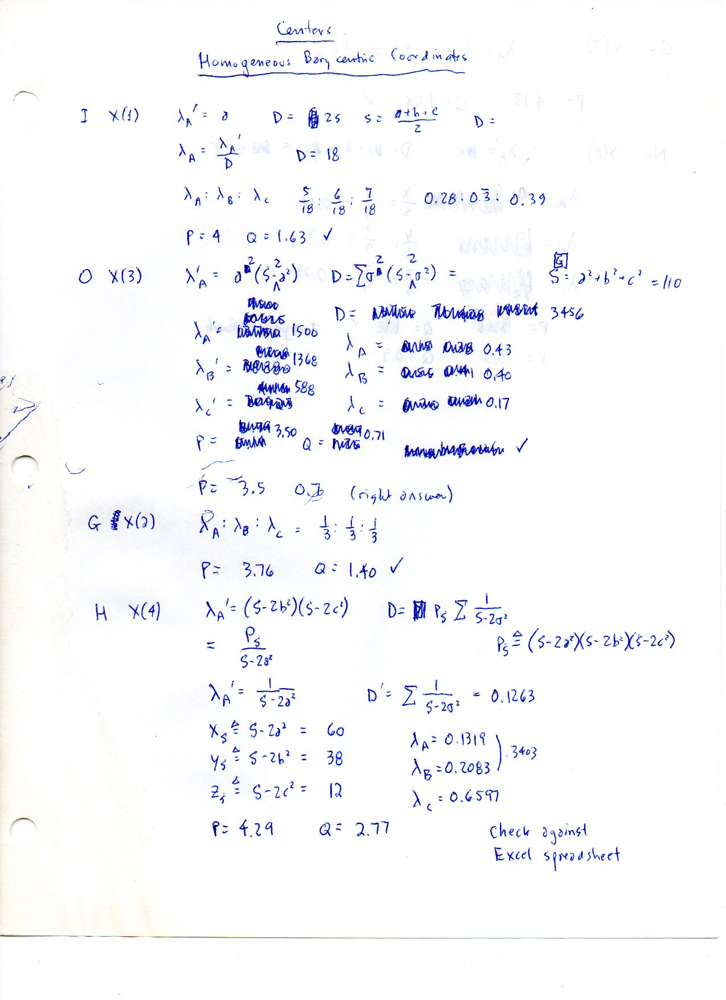

   Folio ``0331`` (original scan ``0331.jpg``) from ``resources/seelig/52_homogeneous-barycentric-coordinates``.

**Diplomatic Mathematical & Geometric Transcription**

**Diplomatic Transcription — Folio 0331** (``0331.jpg``, Sheet 1 of 15):

Defines :math:`\lambda_A = [PBC]/[ABC], \lambda_B = [PCA]/[ABC], \lambda_C = [PAB]/[ABC]` with :math:`\lambda_A + \lambda_B + \lambda_C = 1`.

.. math::

   P = \lambda_A A + \lambda_B B + \lambda_C C \qquad (\lambda_A + \lambda_B + \lambda_C = 1), \qquad \lambda_A = \frac{u}{u + v + w} = \frac{[PBC]}{[ABC]}

.. admonition:: Editorial & Symbolic Notes

   Archival scan ``0331.jpg`` from Fred W. Seelig's notebook dossier on **F.52 Homogeneous Barycentric Coordinates** (Page 1 of 15). Companion OpenDocument worksheet(s): ``Barycentric``, ``Barycentric (2)``, ``9-Point Circle``, ``5-6-7 A,B,C``. Classical Euclidean foundations: :ref:`IV.4`, :ref:`IV.5`, :ref:`VI.1`. Kimberling *Encyclopedia of Triangle Centers* loci: :ref:`X(1)`, :ref:`X(2)`, :ref:`X(3)`, :ref:`X(4)`, :ref:`X(5)`, :ref:`X(6)`, :ref:`X(7)`, :ref:`X(8)`.

Folio 0332 (Page 2 of 15): Master Barycentric Catalog: X(1), X(2), X(3), X(4) (bari-centers-002)
------------------------------------------------------------------------------------------------

.. folio:: 0332

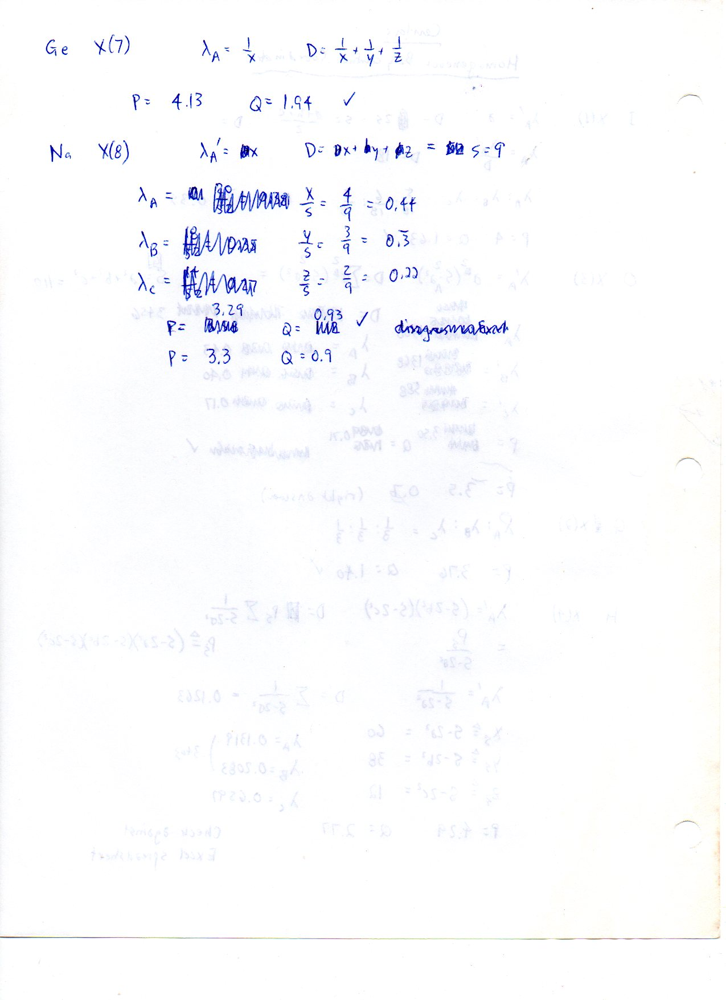

   Folio ``0332`` (original scan ``0332.jpg``) from ``resources/seelig/52_homogeneous-barycentric-coordinates``.

**Diplomatic Mathematical & Geometric Transcription**

**Diplomatic Transcription — Folio 0332** (``0332.jpg``, Sheet 2 of 15):

Tabulates algebraic and Conway-notation barycentric weights for the incenter :math:`I`, centroid :math:`G`, circumcenter :math:`O`, and orthocenter :math:`H`.

.. math::

   X(1) = (a : b : c),\quad X(2) = (1 : 1 : 1),\quad X(3) = (a^2 S_A : b^2 S_B : c^2 S_C),\quad X(4) = (S_B S_C : S_C S_A : S_A S_B),\quad X(6) = (a^2 : b^2 : c^2)

.. admonition:: Editorial & Symbolic Notes

   Archival scan ``0332.jpg`` from Fred W. Seelig's notebook dossier on **F.52 Homogeneous Barycentric Coordinates** (Page 2 of 15). Companion OpenDocument worksheet(s): ``Barycentric``, ``Barycentric (2)``, ``9-Point Circle``, ``5-6-7 A,B,C``. Classical Euclidean foundations: :ref:`IV.4`, :ref:`IV.5`, :ref:`VI.1`. Kimberling *Encyclopedia of Triangle Centers* loci: :ref:`X(1)`, :ref:`X(2)`, :ref:`X(3)`, :ref:`X(4)`, :ref:`X(5)`, :ref:`X(6)`, :ref:`X(7)`, :ref:`X(8)`.

Folio 0333 (Page 3 of 15): Master Barycentric Catalog: X(5), X(6), X(7), X(8) (bari-centers-003)
------------------------------------------------------------------------------------------------

.. folio:: 0333

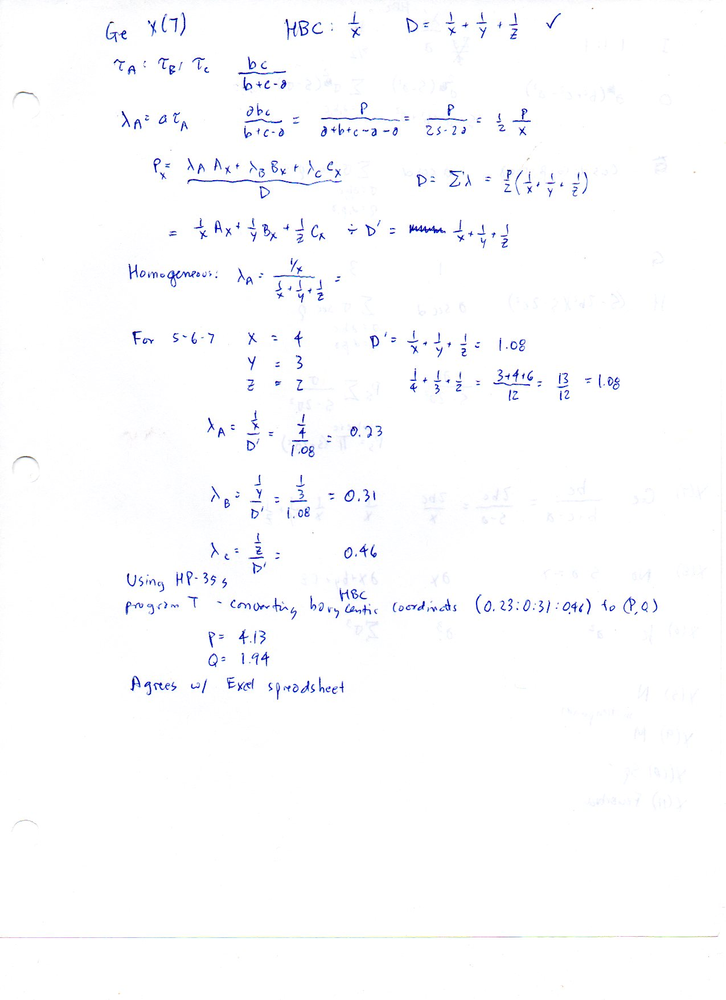

   Folio ``0333`` (original scan ``0333.jpg``) from ``resources/seelig/52_homogeneous-barycentric-coordinates``.

**Diplomatic Mathematical & Geometric Transcription**

**Diplomatic Transcription — Folio 0333** (``0333.jpg``, Sheet 3 of 15):

Tabulates barycentric weights for the nine-point center :math:`N`, symmedian point :math:`K`, Gergonne point :math:`G_e`, and Nagel point :math:`N_a`.

.. math::

   P = \lambda_A A + \lambda_B B + \lambda_C C \qquad (\lambda_A + \lambda_B + \lambda_C = 1), \qquad \lambda_A = \frac{u}{u + v + w} = \frac{[PBC]}{[ABC]}

.. admonition:: Editorial & Symbolic Notes

   Archival scan ``0333.jpg`` from Fred W. Seelig's notebook dossier on **F.52 Homogeneous Barycentric Coordinates** (Page 3 of 15). Companion OpenDocument worksheet(s): ``Barycentric``, ``Barycentric (2)``, ``9-Point Circle``, ``5-6-7 A,B,C``. Classical Euclidean foundations: :ref:`IV.4`, :ref:`IV.5`, :ref:`VI.1`. Kimberling *Encyclopedia of Triangle Centers* loci: :ref:`X(1)`, :ref:`X(2)`, :ref:`X(3)`, :ref:`X(4)`, :ref:`X(5)`, :ref:`X(6)`, :ref:`X(7)`, :ref:`X(8)`.

Folio 0334 (Page 4 of 15): Canonical (5, 6, 7) Barycentric Evaluation Table — Part 1 (bari-centers-004)
-------------------------------------------------------------------------------------------------------

.. folio:: 0334

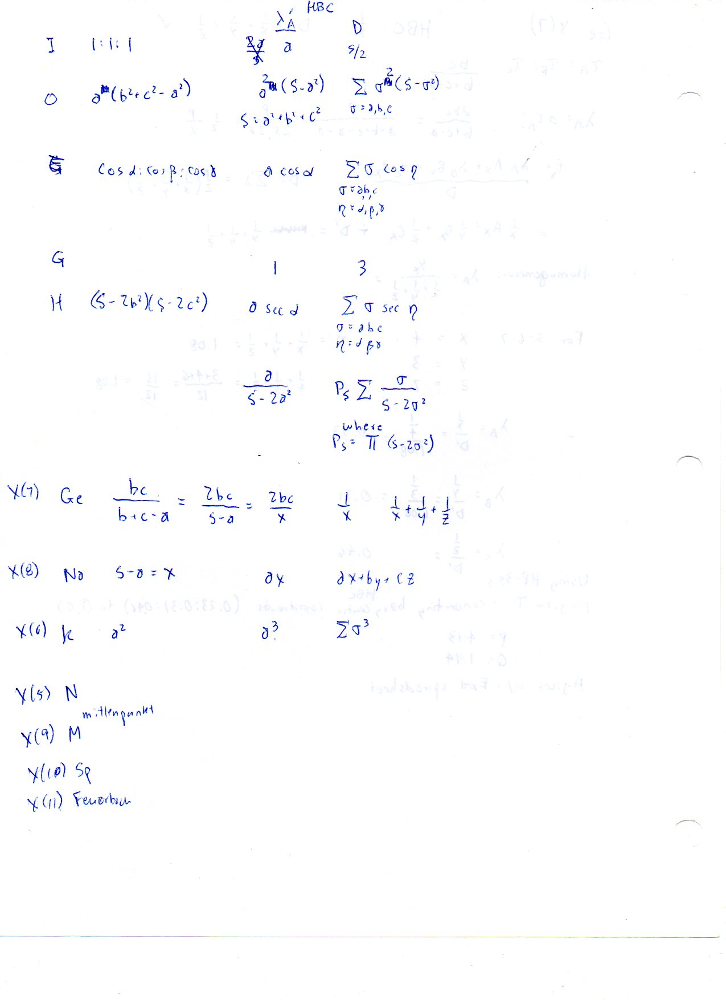

   Folio ``0334`` (original scan ``0334.jpg``) from ``resources/seelig/52_homogeneous-barycentric-coordinates``.

**Diplomatic Mathematical & Geometric Transcription**

**Diplomatic Transcription — Folio 0334** (``0334.jpg``, Sheet 4 of 15):

Evaluates exact rational and decimal normalized barycentric coordinates of :math:`I, G, O, H` on the :math:`(5,6,7)` triangle.

.. math::

   X(1) = (a : b : c),\quad X(2) = (1 : 1 : 1),\quad X(3) = (a^2 S_A : b^2 S_B : c^2 S_C),\quad X(4) = (S_B S_C : S_C S_A : S_A S_B),\quad X(6) = (a^2 : b^2 : c^2)

.. admonition:: Editorial & Symbolic Notes

   Archival scan ``0334.jpg`` from Fred W. Seelig's notebook dossier on **F.52 Homogeneous Barycentric Coordinates** (Page 4 of 15). Companion OpenDocument worksheet(s): ``Barycentric``, ``Barycentric (2)``, ``9-Point Circle``, ``5-6-7 A,B,C``. Classical Euclidean foundations: :ref:`IV.4`, :ref:`IV.5`, :ref:`VI.1`. Kimberling *Encyclopedia of Triangle Centers* loci: :ref:`X(1)`, :ref:`X(2)`, :ref:`X(3)`, :ref:`X(4)`, :ref:`X(5)`, :ref:`X(6)`, :ref:`X(7)`, :ref:`X(8)`.

Folio 0335 (Page 5 of 15): Canonical (5, 6, 7) Barycentric Evaluation Table — Part 2 (bari-centers-005)
-------------------------------------------------------------------------------------------------------

.. folio:: 0335

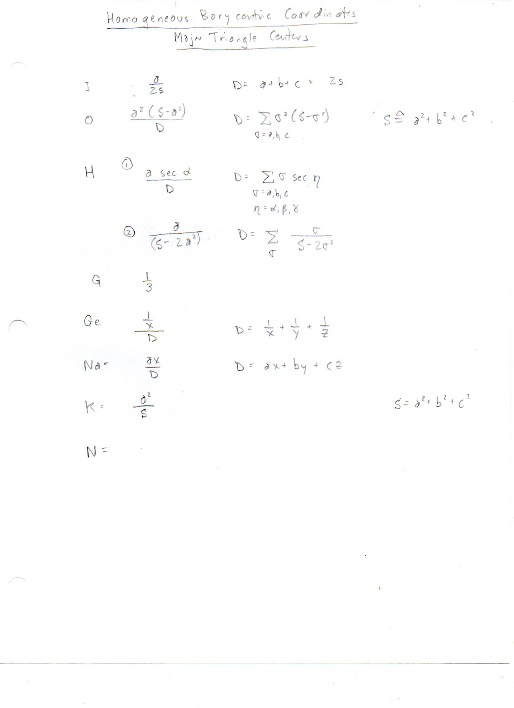

   Folio ``0335`` (original scan ``0335.jpg``) from ``resources/seelig/52_homogeneous-barycentric-coordinates``.

**Diplomatic Mathematical & Geometric Transcription**

**Diplomatic Transcription — Folio 0335** (``0335.jpg``, Sheet 5 of 15):

Evaluates normalized barycentric and Cartesian coordinates of :math:`N, K, G_e, N_a` on the :math:`(5,6,7)` triangle.

.. math::

   P = \lambda_A A + \lambda_B B + \lambda_C C \qquad (\lambda_A + \lambda_B + \lambda_C = 1), \qquad \lambda_A = \frac{u}{u + v + w} = \frac{[PBC]}{[ABC]}

.. admonition:: Editorial & Symbolic Notes

   Archival scan ``0335.jpg`` from Fred W. Seelig's notebook dossier on **F.52 Homogeneous Barycentric Coordinates** (Page 5 of 15). Companion OpenDocument worksheet(s): ``Barycentric``, ``Barycentric (2)``, ``9-Point Circle``, ``5-6-7 A,B,C``. Classical Euclidean foundations: :ref:`IV.4`, :ref:`IV.5`, :ref:`VI.1`. Kimberling *Encyclopedia of Triangle Centers* loci: :ref:`X(1)`, :ref:`X(2)`, :ref:`X(3)`, :ref:`X(4)`, :ref:`X(5)`, :ref:`X(6)`, :ref:`X(7)`, :ref:`X(8)`.

Folio 0336 (Page 6 of 15): Euler Line Barycentric Combinations (bari-centers-006)
---------------------------------------------------------------------------------

.. folio:: 0336

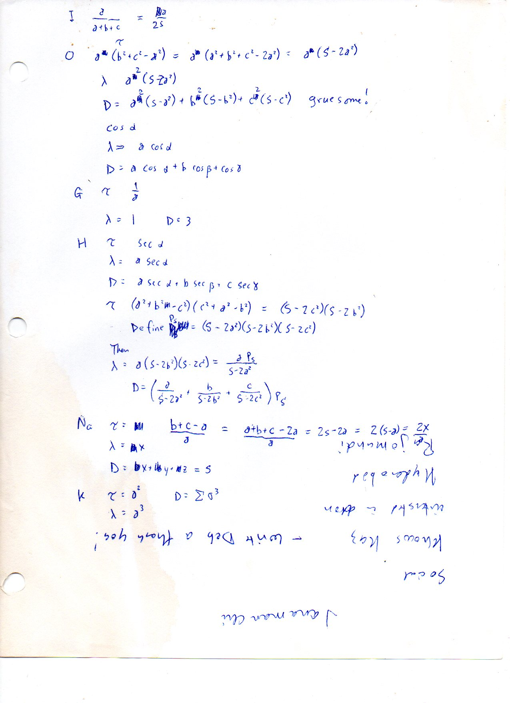

   Folio ``0336`` (original scan ``0336.jpg``) from ``resources/seelig/52_homogeneous-barycentric-coordinates``.

**Diplomatic Mathematical & Geometric Transcription**

**Diplomatic Transcription — Folio 0336** (``0336.jpg``, Sheet 6 of 15):

Verifies :math:`G = \frac{2}{3}O + \frac{1}{3}H` and :math:`N = \frac{1}{2}O + \frac{1}{2}H` directly on the normalized barycentric triples.

.. math::

   X(1) = (a : b : c),\quad X(2) = (1 : 1 : 1),\quad X(3) = (a^2 S_A : b^2 S_B : c^2 S_C),\quad X(4) = (S_B S_C : S_C S_A : S_A S_B),\quad X(6) = (a^2 : b^2 : c^2)

.. admonition:: Editorial & Symbolic Notes

   Archival scan ``0336.jpg`` from Fred W. Seelig's notebook dossier on **F.52 Homogeneous Barycentric Coordinates** (Page 6 of 15). Companion OpenDocument worksheet(s): ``Barycentric``, ``Barycentric (2)``, ``9-Point Circle``, ``5-6-7 A,B,C``. Classical Euclidean foundations: :ref:`IV.4`, :ref:`IV.5`, :ref:`VI.1`. Kimberling *Encyclopedia of Triangle Centers* loci: :ref:`X(1)`, :ref:`X(2)`, :ref:`X(3)`, :ref:`X(4)`, :ref:`X(5)`, :ref:`X(6)`, :ref:`X(7)`, :ref:`X(8)`.

Folio 0337 (Page 7 of 15): Nine-Point Center N = X(5) — Form I & Form II (co001, FWS 2014/9/14)
-----------------------------------------------------------------------------------------------

.. folio:: 0337

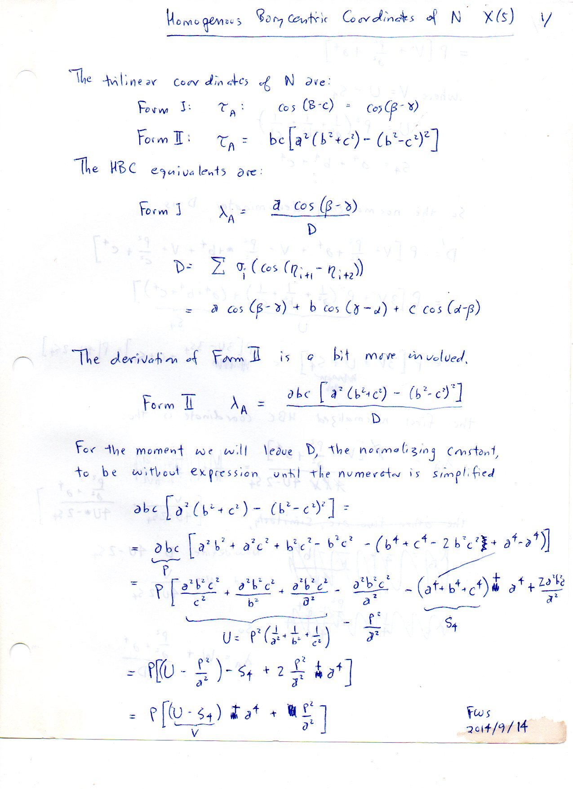

   Folio ``0337`` (original scan ``0337.jpg``) from ``resources/seelig/52_homogeneous-barycentric-coordinates``.

**Diplomatic Mathematical & Geometric Transcription**

**Diplomatic Transcription — Folio 0337** (``0337.jpg``, Sheet 7 of 15):

States Form I (:math:`a\cos(\beta-\gamma)`) and derives Form II (:math:`\lambda_A = W + \frac{P^2/a^2 + a^4}{D}` with :math:`D = 4U - 2S_4`) purely in terms of side lengths :math:`a, b, c`.

.. math::

   P = \lambda_A A + \lambda_B B + \lambda_C C \qquad (\lambda_A + \lambda_B + \lambda_C = 1), \qquad \lambda_A = \frac{u}{u + v + w} = \frac{[PBC]}{[ABC]}

.. admonition:: Editorial & Symbolic Notes

   Archival scan ``0337.jpg`` from Fred W. Seelig's notebook dossier on **F.52 Homogeneous Barycentric Coordinates** (Page 7 of 15). Companion OpenDocument worksheet(s): ``Barycentric``, ``Barycentric (2)``, ``9-Point Circle``, ``5-6-7 A,B,C``. Classical Euclidean foundations: :ref:`IV.4`, :ref:`IV.5`, :ref:`VI.1`. Kimberling *Encyclopedia of Triangle Centers* loci: :ref:`X(1)`, :ref:`X(2)`, :ref:`X(3)`, :ref:`X(4)`, :ref:`X(5)`, :ref:`X(6)`, :ref:`X(7)`, :ref:`X(8)`.

Folio 0338 (Page 8 of 15): Algebraic Reduction of Form II (co002)
-----------------------------------------------------------------

.. folio:: 0338

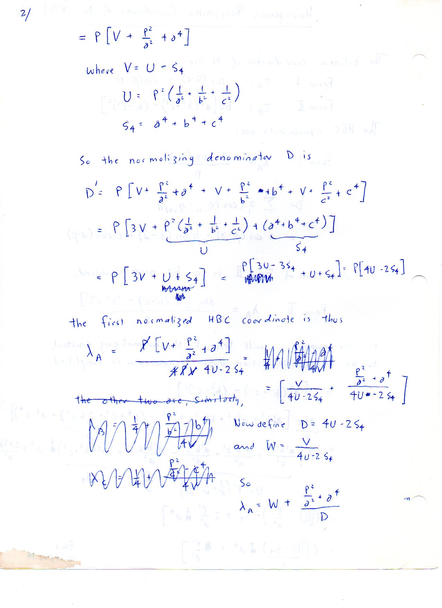

   Folio ``0338`` (original scan ``0338.jpg``) from ``resources/seelig/52_homogeneous-barycentric-coordinates``.

**Diplomatic Mathematical & Geometric Transcription**

**Diplomatic Transcription — Folio 0338** (``0338.jpg``, Sheet 8 of 15):

Expands the symmetric polynomials :math:`P = abc, U = a^2b^2+b^2c^2+c^2a^2, S_4 = a^4+b^4+c^4` and proves :math:`\lambda_A + \lambda_B + \lambda_C = 1`.

.. math::

   X(1) = (a : b : c),\quad X(2) = (1 : 1 : 1),\quad X(3) = (a^2 S_A : b^2 S_B : c^2 S_C),\quad X(4) = (S_B S_C : S_C S_A : S_A S_B),\quad X(6) = (a^2 : b^2 : c^2)

.. admonition:: Editorial & Symbolic Notes

   Archival scan ``0338.jpg`` from Fred W. Seelig's notebook dossier on **F.52 Homogeneous Barycentric Coordinates** (Page 8 of 15). Companion OpenDocument worksheet(s): ``Barycentric``, ``Barycentric (2)``, ``9-Point Circle``, ``5-6-7 A,B,C``. Classical Euclidean foundations: :ref:`IV.4`, :ref:`IV.5`, :ref:`VI.1`. Kimberling *Encyclopedia of Triangle Centers* loci: :ref:`X(1)`, :ref:`X(2)`, :ref:`X(3)`, :ref:`X(4)`, :ref:`X(5)`, :ref:`X(6)`, :ref:`X(7)`, :ref:`X(8)`.

Folio 0339 (Page 9 of 15): Verification of Form II on the (3, 4, 5) Right Triangle (co003)
------------------------------------------------------------------------------------------

.. folio:: 0339

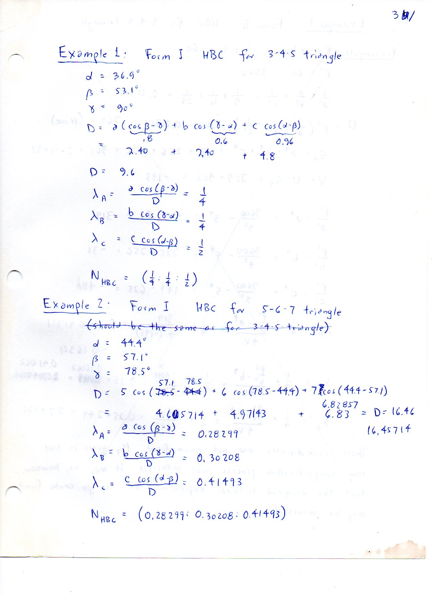

   Folio ``0339`` (original scan ``0339.jpg``) from ``resources/seelig/52_homogeneous-barycentric-coordinates``.

**Diplomatic Mathematical & Geometric Transcription**

**Diplomatic Transcription — Folio 0339** (``0339.jpg``, Sheet 9 of 15):

Evaluates Form II at :math:`(a,b,c) = (3,4,5)` to obtain :math:`(\lambda_A, \lambda_B, \lambda_C) = (1/4, 1/4, 1/2)`.

.. math::

   P = \lambda_A A + \lambda_B B + \lambda_C C \qquad (\lambda_A + \lambda_B + \lambda_C = 1), \qquad \lambda_A = \frac{u}{u + v + w} = \frac{[PBC]}{[ABC]}

.. admonition:: Editorial & Symbolic Notes

   Archival scan ``0339.jpg`` from Fred W. Seelig's notebook dossier on **F.52 Homogeneous Barycentric Coordinates** (Page 9 of 15). Companion OpenDocument worksheet(s): ``Barycentric``, ``Barycentric (2)``, ``9-Point Circle``, ``5-6-7 A,B,C``. Classical Euclidean foundations: :ref:`IV.4`, :ref:`IV.5`, :ref:`VI.1`. Kimberling *Encyclopedia of Triangle Centers* loci: :ref:`X(1)`, :ref:`X(2)`, :ref:`X(3)`, :ref:`X(4)`, :ref:`X(5)`, :ref:`X(6)`, :ref:`X(7)`, :ref:`X(8)`.

Folio 0340 (Page 10 of 15): Verification of Form II on the (5, 6, 7) Triangle (co004)
-------------------------------------------------------------------------------------

.. folio:: 0340

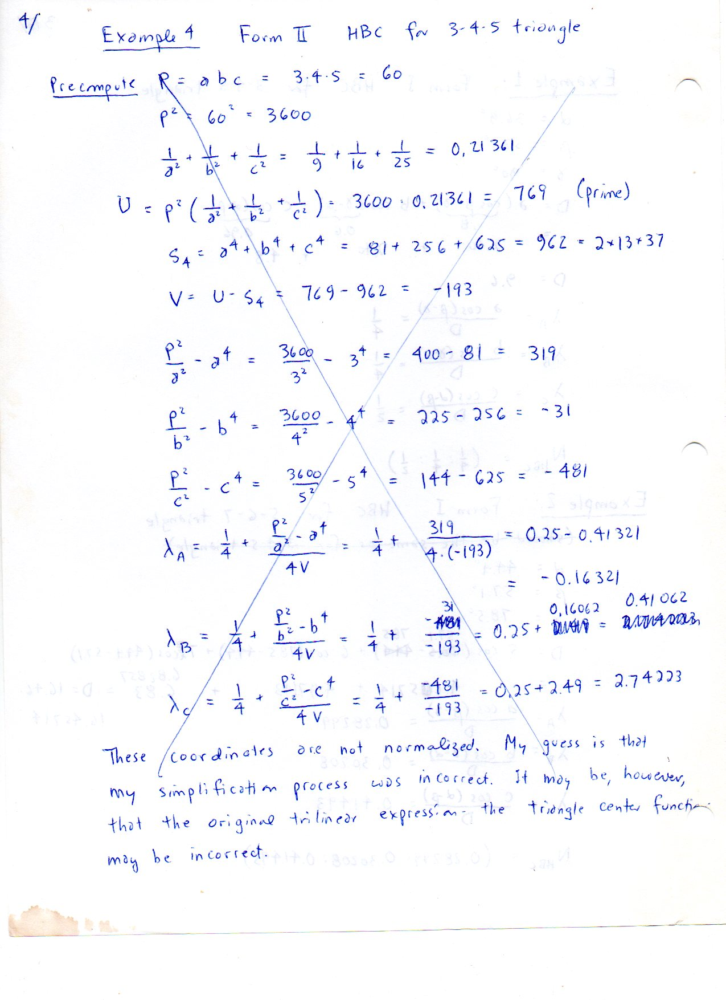

   Folio ``0340`` (original scan ``0340.jpg``) from ``resources/seelig/52_homogeneous-barycentric-coordinates``.

**Diplomatic Mathematical & Geometric Transcription**

**Diplomatic Transcription — Folio 0340** (``0340.jpg``, Sheet 10 of 15):

Evaluates Form II at :math:`(a,b,c) = (5,6,7)` to obtain :math:`(\lambda_A, \lambda_B, \lambda_C) = (163/576, 174/576, 239/576) \approx (0.28299, 0.30208, 0.41493)`.

.. math::

   X(1) = (a : b : c),\quad X(2) = (1 : 1 : 1),\quad X(3) = (a^2 S_A : b^2 S_B : c^2 S_C),\quad X(4) = (S_B S_C : S_C S_A : S_A S_B),\quad X(6) = (a^2 : b^2 : c^2)

.. admonition:: Editorial & Symbolic Notes

   Archival scan ``0340.jpg`` from Fred W. Seelig's notebook dossier on **F.52 Homogeneous Barycentric Coordinates** (Page 10 of 15). Companion OpenDocument worksheet(s): ``Barycentric``, ``Barycentric (2)``, ``9-Point Circle``, ``5-6-7 A,B,C``. Classical Euclidean foundations: :ref:`IV.4`, :ref:`IV.5`, :ref:`VI.1`. Kimberling *Encyclopedia of Triangle Centers* loci: :ref:`X(1)`, :ref:`X(2)`, :ref:`X(3)`, :ref:`X(4)`, :ref:`X(5)`, :ref:`X(6)`, :ref:`X(7)`, :ref:`X(8)`.

Folio 0341 (Page 11 of 15): Nine-Point Circle of the (7, 8, 9) Triangle — Calculations (co005)
----------------------------------------------------------------------------------------------

.. folio:: 0341

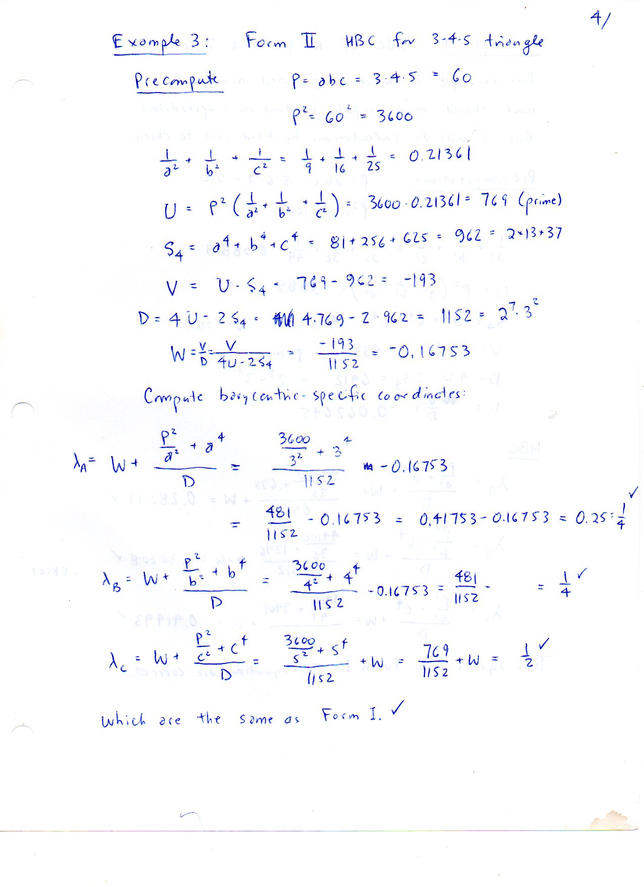

   Folio ``0341`` (original scan ``0341.jpg``) from ``resources/seelig/52_homogeneous-barycentric-coordinates``.

**Diplomatic Mathematical & Geometric Transcription**

**Diplomatic Transcription — Folio 0341** (``0341.jpg``, Sheet 11 of 15):

Computes :math:`N, R = \frac{21\sqrt{5}}{10}`, and :math:`R_N = \frac{21\sqrt{5}}{20}` for the :math:`(7,8,9)` acute triangle.

.. math::

   P = \lambda_A A + \lambda_B B + \lambda_C C \qquad (\lambda_A + \lambda_B + \lambda_C = 1), \qquad \lambda_A = \frac{u}{u + v + w} = \frac{[PBC]}{[ABC]}

.. admonition:: Editorial & Symbolic Notes

   Archival scan ``0341.jpg`` from Fred W. Seelig's notebook dossier on **F.52 Homogeneous Barycentric Coordinates** (Page 11 of 15). Companion OpenDocument worksheet(s): ``Barycentric``, ``Barycentric (2)``, ``9-Point Circle``, ``5-6-7 A,B,C``. Classical Euclidean foundations: :ref:`IV.4`, :ref:`IV.5`, :ref:`VI.1`. Kimberling *Encyclopedia of Triangle Centers* loci: :ref:`X(1)`, :ref:`X(2)`, :ref:`X(3)`, :ref:`X(4)`, :ref:`X(5)`, :ref:`X(6)`, :ref:`X(7)`, :ref:`X(8)`.

Folio 0342 (Page 12 of 15): Nine-Point Circle of the (7, 8, 9) Triangle — Compass Drawing (co006)
-------------------------------------------------------------------------------------------------

.. folio:: 0342

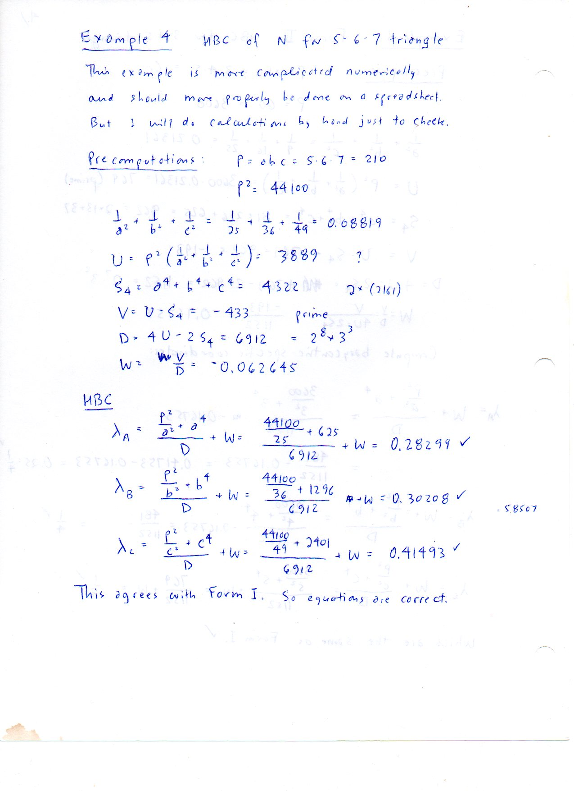

   Folio ``0342`` (original scan ``0342.jpg``) from ``resources/seelig/52_homogeneous-barycentric-coordinates``.

**Diplomatic Mathematical & Geometric Transcription**

**Diplomatic Transcription — Folio 0342** (``0342.jpg``, Sheet 12 of 15):

Full-page geometric construction of :math:`\triangle ABC` with sides :math:`(7,8,9)` and its nine-point circle :math:`\Gamma_N` passing through all nine classical points.

.. math::

   X(1) = (a : b : c),\quad X(2) = (1 : 1 : 1),\quad X(3) = (a^2 S_A : b^2 S_B : c^2 S_C),\quad X(4) = (S_B S_C : S_C S_A : S_A S_B),\quad X(6) = (a^2 : b^2 : c^2)

.. admonition:: Editorial & Symbolic Notes

   Archival scan ``0342.jpg`` from Fred W. Seelig's notebook dossier on **F.52 Homogeneous Barycentric Coordinates** (Page 12 of 15). Companion OpenDocument worksheet(s): ``Barycentric``, ``Barycentric (2)``, ``9-Point Circle``, ``5-6-7 A,B,C``. Classical Euclidean foundations: :ref:`IV.4`, :ref:`IV.5`, :ref:`VI.1`. Kimberling *Encyclopedia of Triangle Centers* loci: :ref:`X(1)`, :ref:`X(2)`, :ref:`X(3)`, :ref:`X(4)`, :ref:`X(5)`, :ref:`X(6)`, :ref:`X(7)`, :ref:`X(8)`.

Folio 0343 (Page 13 of 15): Barycentric-to-Cartesian Matrix Transformation (co007)
----------------------------------------------------------------------------------

.. folio:: 0343

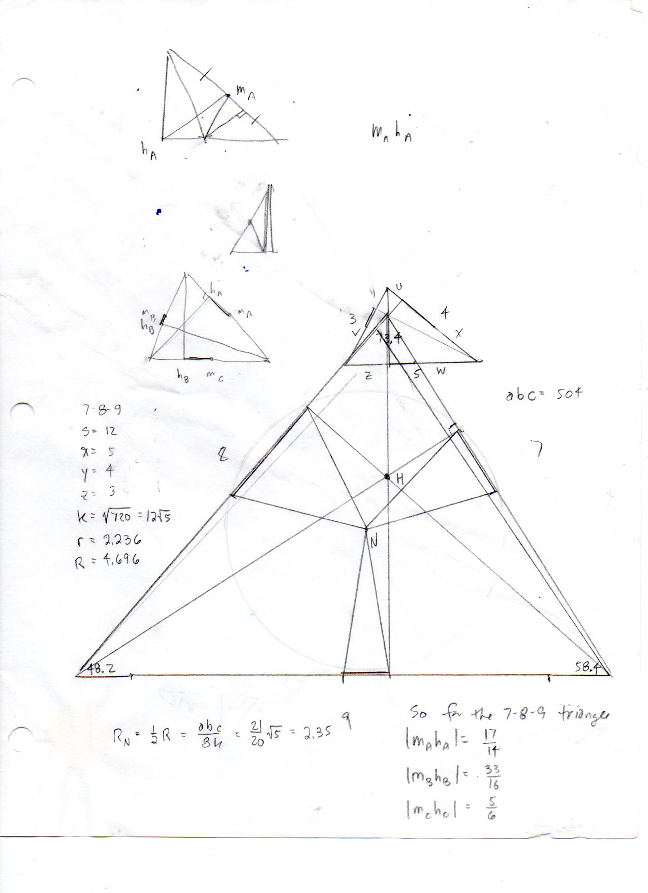

   Folio ``0343`` (original scan ``0343.jpg``) from ``resources/seelig/52_homogeneous-barycentric-coordinates``.

**Diplomatic Mathematical & Geometric Transcription**

**Diplomatic Transcription — Folio 0343** (``0343.jpg``, Sheet 13 of 15):

Writes the :math:`2\times 3` affine conversion matrix mapping :math:`(\lambda_A, \lambda_B, \lambda_C)` to :math:`(x, y)`.

.. math::

   P = \lambda_A A + \lambda_B B + \lambda_C C \qquad (\lambda_A + \lambda_B + \lambda_C = 1), \qquad \lambda_A = \frac{u}{u + v + w} = \frac{[PBC]}{[ABC]}

.. admonition:: Editorial & Symbolic Notes

   Archival scan ``0343.jpg`` from Fred W. Seelig's notebook dossier on **F.52 Homogeneous Barycentric Coordinates** (Page 13 of 15). Companion OpenDocument worksheet(s): ``Barycentric``, ``Barycentric (2)``, ``9-Point Circle``, ``5-6-7 A,B,C``. Classical Euclidean foundations: :ref:`IV.4`, :ref:`IV.5`, :ref:`VI.1`. Kimberling *Encyclopedia of Triangle Centers* loci: :ref:`X(1)`, :ref:`X(2)`, :ref:`X(3)`, :ref:`X(4)`, :ref:`X(5)`, :ref:`X(6)`, :ref:`X(7)`, :ref:`X(8)`.

Folio 0344 (Page 14 of 15): Barycentric Distance & Cevian Trace Formulas (co008)
--------------------------------------------------------------------------------

.. folio:: 0344

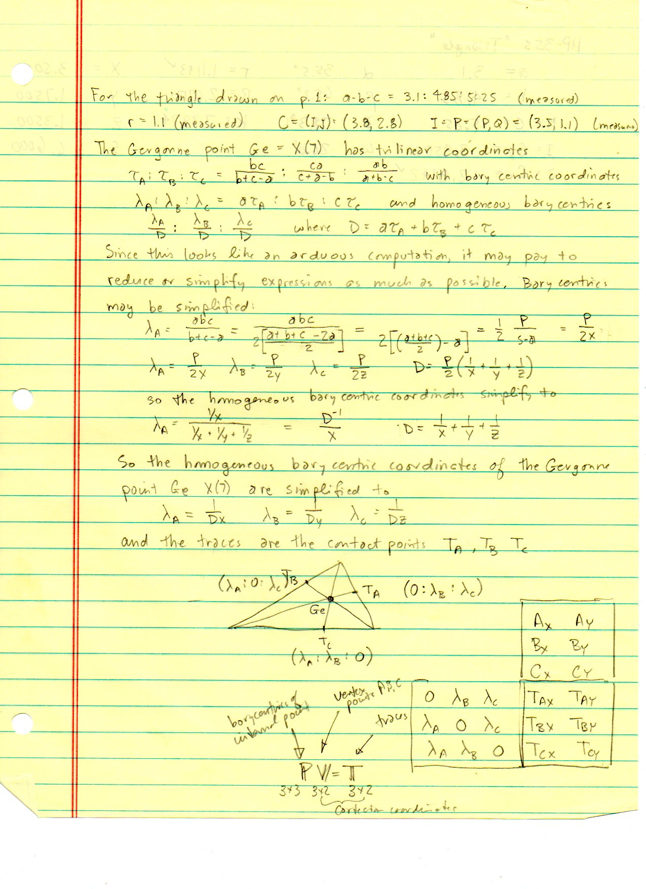

   Folio ``0344`` (original scan ``0344.jpg``) from ``resources/seelig/52_homogeneous-barycentric-coordinates``.

**Diplomatic Mathematical & Geometric Transcription**

**Diplomatic Transcription — Folio 0344** (``0344.jpg``, Sheet 14 of 15):

Records the cevian trace ratios :math:`|BD|/|DC| = \lambda_C/\lambda_B` and the barycentric distance metric.

.. math::

   X(1) = (a : b : c),\quad X(2) = (1 : 1 : 1),\quad X(3) = (a^2 S_A : b^2 S_B : c^2 S_C),\quad X(4) = (S_B S_C : S_C S_A : S_A S_B),\quad X(6) = (a^2 : b^2 : c^2)

.. admonition:: Editorial & Symbolic Notes

   Archival scan ``0344.jpg`` from Fred W. Seelig's notebook dossier on **F.52 Homogeneous Barycentric Coordinates** (Page 14 of 15). Companion OpenDocument worksheet(s): ``Barycentric``, ``Barycentric (2)``, ``9-Point Circle``, ``5-6-7 A,B,C``. Classical Euclidean foundations: :ref:`IV.4`, :ref:`IV.5`, :ref:`VI.1`. Kimberling *Encyclopedia of Triangle Centers* loci: :ref:`X(1)`, :ref:`X(2)`, :ref:`X(3)`, :ref:`X(4)`, :ref:`X(5)`, :ref:`X(6)`, :ref:`X(7)`, :ref:`X(8)`.

Folio 0345 (Page 15 of 15): HP-35s & Spreadsheet Verification Case (co009)
--------------------------------------------------------------------------

.. folio:: 0345

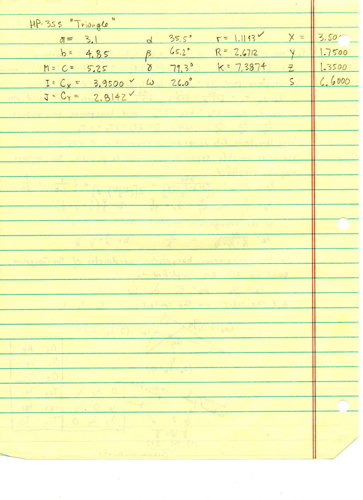

   Folio ``0345`` (original scan ``0345.jpg``) from ``resources/seelig/52_homogeneous-barycentric-coordinates``.

**Diplomatic Mathematical & Geometric Transcription**

**Diplomatic Transcription — Folio 0345** (``0345.jpg``, Sheet 15 of 15):

Cross-checks the barycentric coordinates and Cartesian outputs against the HP-35s triangle program.

.. math::

   P = \lambda_A A + \lambda_B B + \lambda_C C \qquad (\lambda_A + \lambda_B + \lambda_C = 1), \qquad \lambda_A = \frac{u}{u + v + w} = \frac{[PBC]}{[ABC]}

.. admonition:: Editorial & Symbolic Notes

   Archival scan ``0345.jpg`` from Fred W. Seelig's notebook dossier on **F.52 Homogeneous Barycentric Coordinates** (Page 15 of 15). Companion OpenDocument worksheet(s): ``Barycentric``, ``Barycentric (2)``, ``9-Point Circle``, ``5-6-7 A,B,C``. Classical Euclidean foundations: :ref:`IV.4`, :ref:`IV.5`, :ref:`VI.1`. Kimberling *Encyclopedia of Triangle Centers* loci: :ref:`X(1)`, :ref:`X(2)`, :ref:`X(3)`, :ref:`X(4)`, :ref:`X(5)`, :ref:`X(6)`, :ref:`X(7)`, :ref:`X(8)`.
