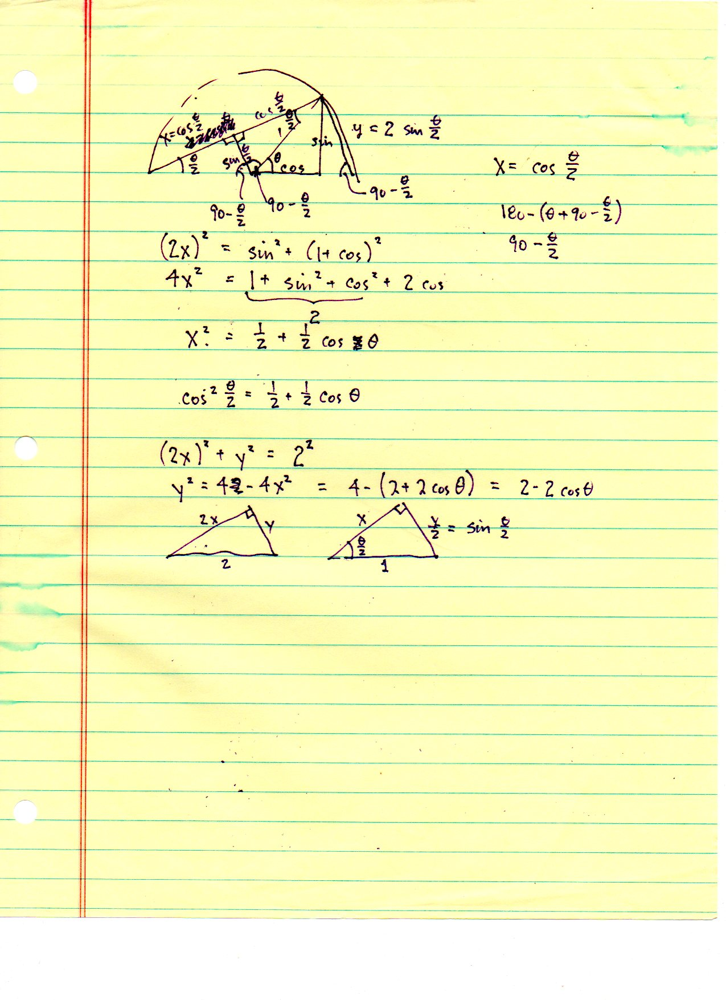

===============================================
F.53 Geometric Half-Angle Trigonometry — Folios
===============================================

Archival manuscript scans and diplomatic transcriptions from :person:`seelig`'s
notebooks for **F.53 (Geometric Half-Angle Trigonometry)** (:cite:`SeeligNotebooks`).

Folio 0346 (Page 1 of 1): Unit Semicircle Proof of Half-Angle Identities
------------------------------------------------------------------------

.. folio:: 0346

   Folio ``0346`` (original scan ``0346.jpg``) from ``resources/seelig/53_trig``.

**Diplomatic Mathematical & Geometric Transcription**

**Diplomatic Transcription — Folio 0346** (``0346.jpg``, Sheet 1 of 1):

Constructs right triangle :math:`AHP` inside a unit semicircle (:math:`R=1, |AH|=1+\cos\theta, |PH|=\sin\theta, |AP|=2\cos(\theta/2)`) to prove :math:`\cos^2(\theta/2) = \frac{1}{2}(1+\cos\theta)` and :math:`\sin^2(\theta/2) = \frac{1}{2}(1-\cos\theta)`.

.. math::

   (2 x)^2 = \sin^2\theta + (1 + \cos\theta)^2 = 2 + 2\cos\theta \implies \cos^2\frac{\theta}{2} = \frac{1 + \cos\theta}{2}

.. admonition:: Editorial & Symbolic Notes

   Archival scan ``0346.jpg`` from Fred W. Seelig's notebook dossier on **F.53 Geometric Half-Angle Trigonometry** (Page 1 of 1). Companion OpenDocument worksheet(s): ``Trig Identities``, ``General Reference``. Classical Euclidean foundations: :ref:`I.47`, :ref:`III.20`, :ref:`III.31`.
