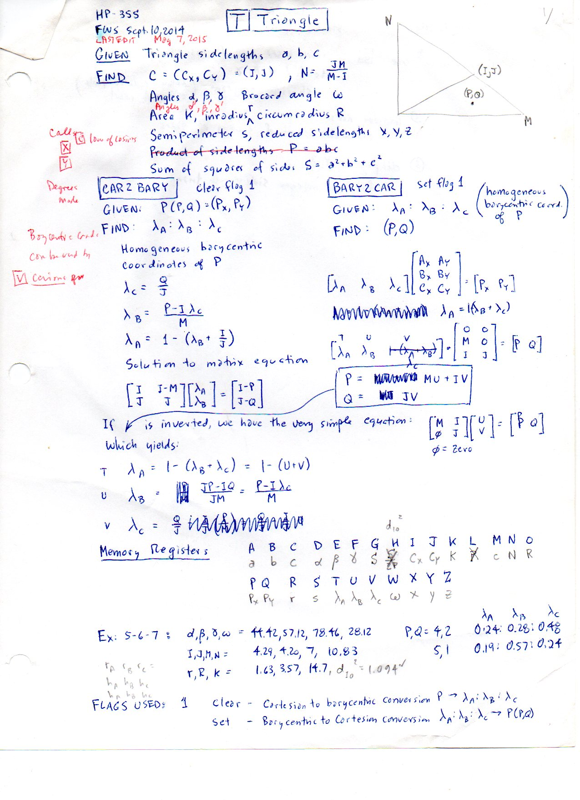
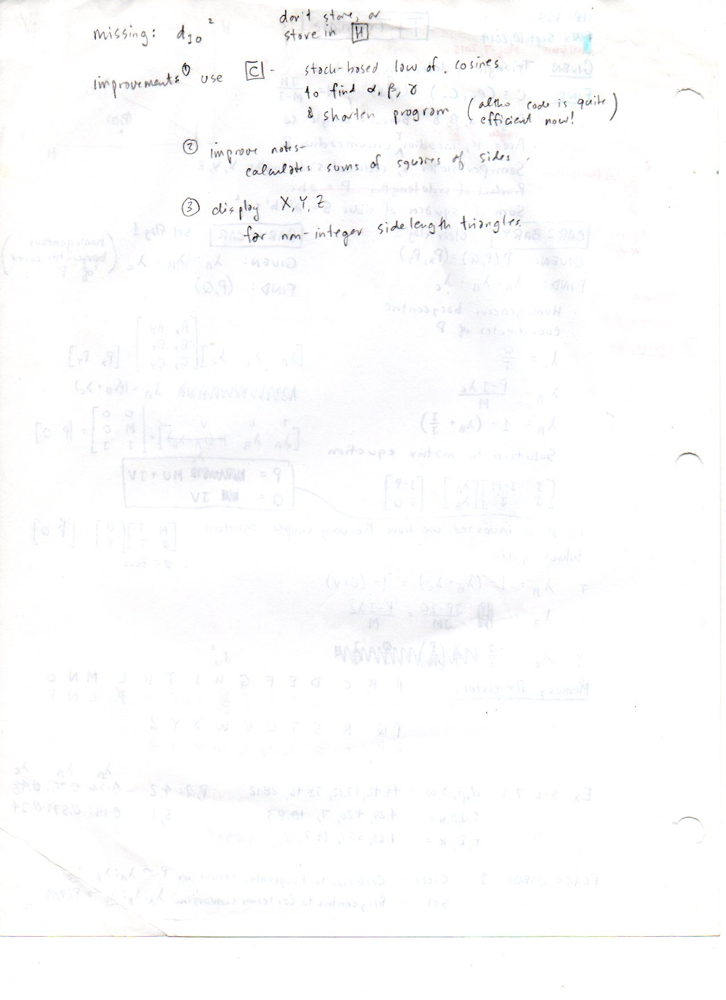

============================================================
F.54 HP-35s Triangle Program and Coordinate Scripts — Folios
============================================================

Archival manuscript scans and diplomatic transcriptions from :person:`seelig`'s
notebooks for **F.54 (HP-35s Triangle Program and Coordinate Scripts)** (:cite:`SeeligNotebooks`).

Folio 0347 (Page 1 of 2): HP-35s [T] [Triangle] Program Specification (FWS Sept. 10, 2014 / May 7, 2015)
--------------------------------------------------------------------------------------------------------

.. folio:: 0347

   Folio ``0347`` (original scan ``0347.jpg``) from ``resources/seelig/54_scripts``.

**Diplomatic Mathematical & Geometric Transcription**

**Diplomatic Transcription — Folio 0347** (``0347.jpg``, Sheet 1 of 2):

Defines the ``BARY 2 CAR`` (:math:`P = MU+IV, Q = JV`) and ``CAR 2 BARY`` (:math:`V = Q/J, U = (P-IV)/M, T = 1-(U+V)`) routines for :math:`A=(0,0), B=(M,0), C=(I,J)`.

.. math::

   \text{BARY 2 CAR:}\quad \begin{bmatrix} P \\ Q \end{bmatrix} = \begin{bmatrix} M & I \\ 0 & J \end{bmatrix} \begin{bmatrix} U \\ V \end{bmatrix}, \qquad T + U + V = 1

.. admonition:: Editorial & Symbolic Notes

   Archival scan ``0347.jpg`` from Fred W. Seelig's notebook dossier on **F.54 HP-35s Triangle Program and Coordinate Scripts** (Page 1 of 2). Companion OpenDocument worksheet(s): ``Barycentric``, ``5-6-7 A,B,C``. Classical Euclidean foundations: :ref:`VI.2`. Kimberling *Encyclopedia of Triangle Centers* loci: :ref:`X(1)`, :ref:`X(2)`, :ref:`X(3)`, :ref:`X(4)`.

Folio 0348 (Page 2 of 2): HP-35s Register Map A–Z & (5, 6, 7) Test Case
-----------------------------------------------------------------------

.. folio:: 0348

   Folio ``0348`` (original scan ``0348.jpg``) from ``resources/seelig/54_scripts``.

**Diplomatic Mathematical & Geometric Transcription**

**Diplomatic Transcription — Folio 0348** (``0348.jpg``, Sheet 2 of 2):

Documents the allocation of calculator registers ``A`` through ``Z`` and verifies the forward and inverse routines on the :math:`(5,6,7)` triangle.

.. math::

   \text{CAR 2 BARY:}\quad V = \frac{Q}{J}, \qquad U = \frac{P - I V}{M}, \qquad T = 1 - (U + V)

.. admonition:: Editorial & Symbolic Notes

   Archival scan ``0348.jpg`` from Fred W. Seelig's notebook dossier on **F.54 HP-35s Triangle Program and Coordinate Scripts** (Page 2 of 2). Companion OpenDocument worksheet(s): ``Barycentric``, ``5-6-7 A,B,C``. Classical Euclidean foundations: :ref:`VI.2`. Kimberling *Encyclopedia of Triangle Centers* loci: :ref:`X(1)`, :ref:`X(2)`, :ref:`X(3)`, :ref:`X(4)`.
