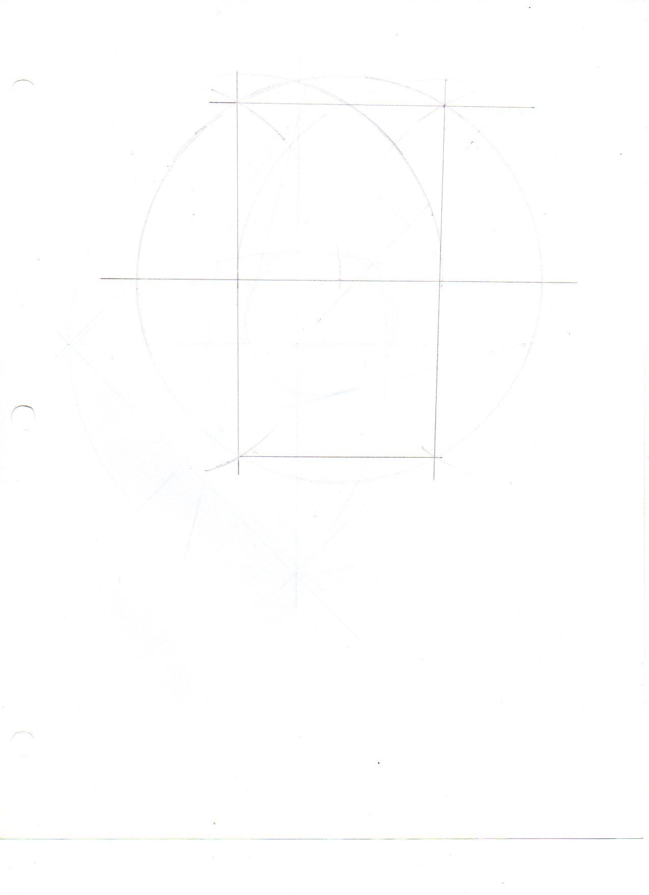
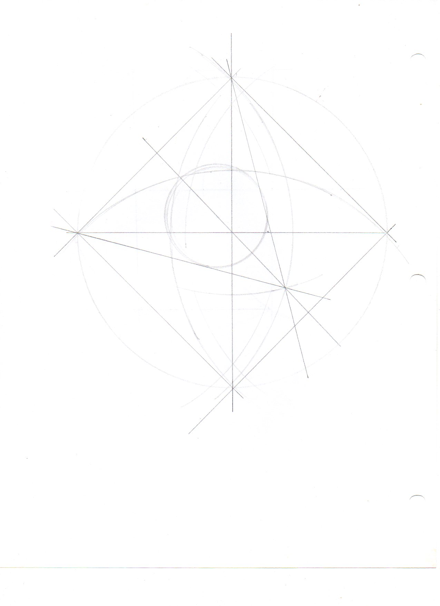
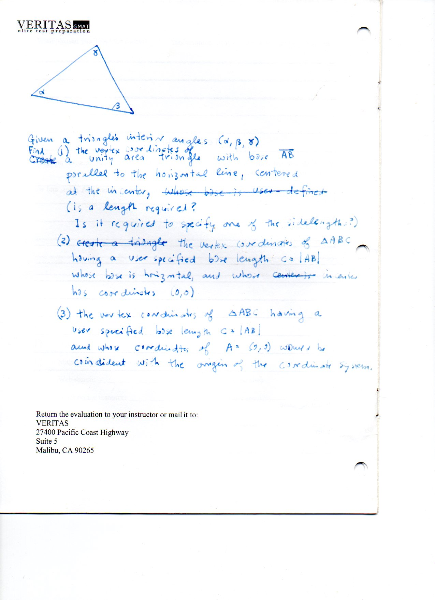
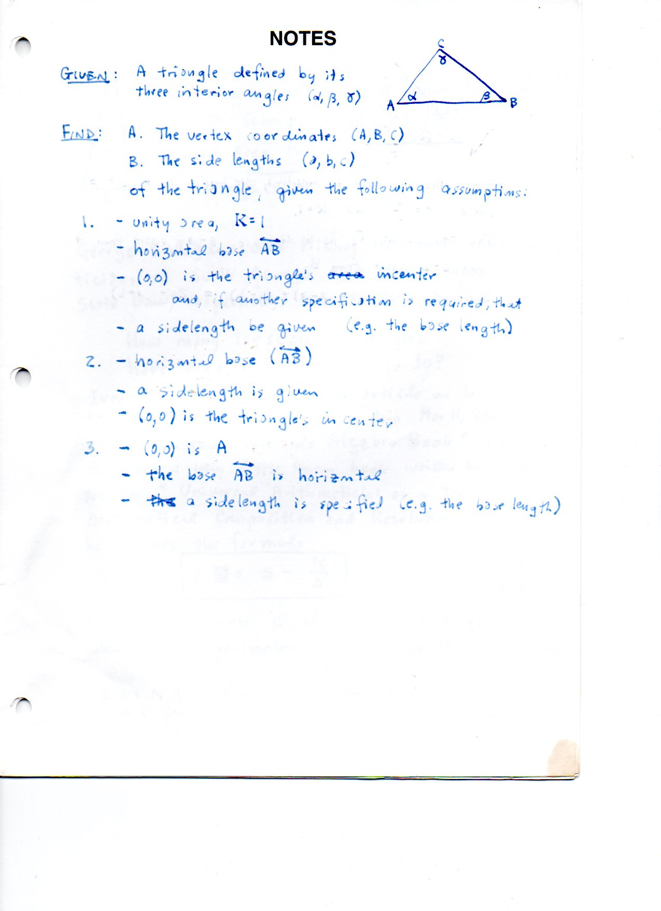
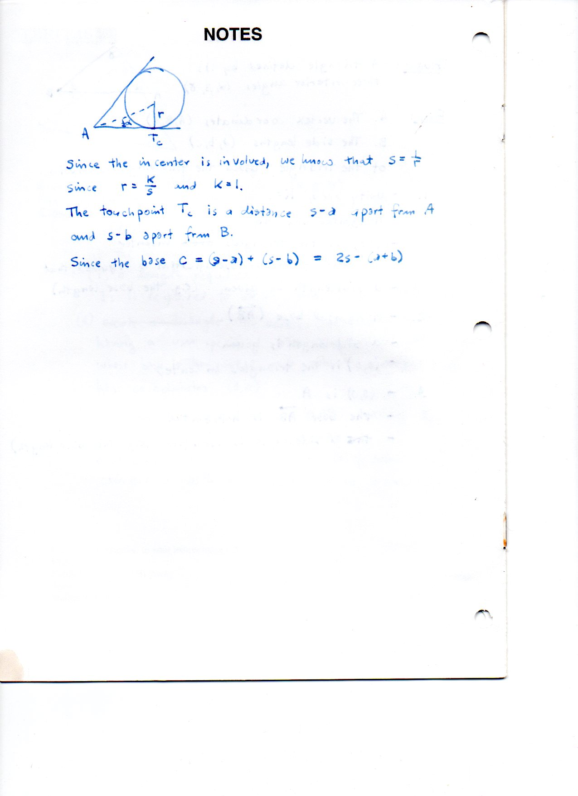

=============================================================================
F.55 Compass Constructions and Angle-to-Side Triangle Reconstruction — Folios
=============================================================================

Archival manuscript scans and diplomatic transcriptions from :person:`seelig`'s
notebooks for **F.55 (Compass Constructions and Angle-to-Side Triangle Reconstruction)** (:cite:`SeeligNotebooks`).

Folio 0349 (Page 1 of 5): Compass Construction — Vesica Piscis & Orthogonal Axes (drawings-001)
-----------------------------------------------------------------------------------------------

.. folio:: 0349

   Folio ``0349`` (original scan ``0349.jpg``) from ``resources/seelig/55_misc``.

**Diplomatic Mathematical & Geometric Transcription**

**Diplomatic Transcription — Folio 0349** (``0349.jpg``, Sheet 1 of 5):

Full-page compass and straightedge construction of a vesica piscis, perpendicular bisector, and inscribed circles.

.. math::

   s - a = r\cot\frac{\alpha}{2}, \qquad s - b = r\cot\frac{\beta}{2}, \qquad s - c = r\cot\frac{\gamma}{2}

.. admonition:: Editorial & Symbolic Notes

   Archival scan ``0349.jpg`` from Fred W. Seelig's notebook dossier on **F.55 Compass Constructions and Angle-to-Side Triangle Reconstruction** (Page 1 of 5). Companion OpenDocument worksheet(s): ``General Reference``, ``Incircle-Incenter``. Classical Euclidean foundations: :ref:`I.1`, :ref:`IV.4`. Kimberling *Encyclopedia of Triangle Centers* loci: :ref:`X(1)`, :ref:`X(7)`.

Folio 0350 (Page 2 of 5): Compass Construction — Inscribed Square & Diagonal Grid (drawings-002)
------------------------------------------------------------------------------------------------

.. folio:: 0350

   Folio ``0350`` (original scan ``0350.jpg``) from ``resources/seelig/55_misc``.

**Diplomatic Mathematical & Geometric Transcription**

**Diplomatic Transcription — Folio 0350** (``0350.jpg``, Sheet 2 of 5):

Compass construction of a circle, orthogonal diameters, and inscribed square with auxiliary secant lines.

.. math::

   K = r s = 1 \implies s = \frac{1}{r}, \qquad c = (s - a) + (s - b) = 2 s - (a + b)

.. admonition:: Editorial & Symbolic Notes

   Archival scan ``0350.jpg`` from Fred W. Seelig's notebook dossier on **F.55 Compass Constructions and Angle-to-Side Triangle Reconstruction** (Page 2 of 5). Companion OpenDocument worksheet(s): ``General Reference``, ``Incircle-Incenter``. Classical Euclidean foundations: :ref:`I.1`, :ref:`IV.4`. Kimberling *Encyclopedia of Triangle Centers* loci: :ref:`X(1)`, :ref:`X(7)`.

Folio 0351 (Page 3 of 5): Reconstructing a Triangle from Angles (alpha, beta, gamma) — Assumption Sets (misc-2-001)
-------------------------------------------------------------------------------------------------------------------

.. folio:: 0351

   Folio ``0351`` (original scan ``0351.jpg``) from ``resources/seelig/55_misc``.

**Diplomatic Mathematical & Geometric Transcription**

**Diplomatic Transcription — Folio 0351** (``0351.jpg``, Sheet 3 of 5):

Sets up the problem of determining :math:`(a,b,c)` and vertex coordinates :math:`(A,B,C)` from :math:`(\alpha, \beta, \gamma)` under three scale normalizations (:math:`c=1`, :math:`R=1`, or :math:`K=1`).

.. math::

   s - a = r\cot\frac{\alpha}{2}, \qquad s - b = r\cot\frac{\beta}{2}, \qquad s - c = r\cot\frac{\gamma}{2}

.. admonition:: Editorial & Symbolic Notes

   Archival scan ``0351.jpg`` from Fred W. Seelig's notebook dossier on **F.55 Compass Constructions and Angle-to-Side Triangle Reconstruction** (Page 3 of 5). Companion OpenDocument worksheet(s): ``General Reference``, ``Incircle-Incenter``. Classical Euclidean foundations: :ref:`I.1`, :ref:`IV.4`. Kimberling *Encyclopedia of Triangle Centers* loci: :ref:`X(1)`, :ref:`X(7)`.

Folio 0352 (Page 4 of 5): Unit-Area Normalization K = 1 & Intouch Cotangents (misc-2-002)
-----------------------------------------------------------------------------------------

.. folio:: 0352

   Folio ``0352`` (original scan ``0352.jpg``) from ``resources/seelig/55_misc``.

**Diplomatic Mathematical & Geometric Transcription**

**Diplomatic Transcription — Folio 0352** (``0352.jpg``, Sheet 4 of 5):

Uses :math:`K = rs = 1 \implies s = 1/r` and :math:`s - a = r\cot(\alpha/2), s - b = r\cot(\beta/2)` to solve for :math:`r, s`, and :math:`(a,b,c)`.

.. math::

   K = r s = 1 \implies s = \frac{1}{r}, \qquad c = (s - a) + (s - b) = 2 s - (a + b)

.. admonition:: Editorial & Symbolic Notes

   Archival scan ``0352.jpg`` from Fred W. Seelig's notebook dossier on **F.55 Compass Constructions and Angle-to-Side Triangle Reconstruction** (Page 4 of 5). Companion OpenDocument worksheet(s): ``General Reference``, ``Incircle-Incenter``. Classical Euclidean foundations: :ref:`I.1`, :ref:`IV.4`. Kimberling *Encyclopedia of Triangle Centers* loci: :ref:`X(1)`, :ref:`X(7)`.

Folio 0353 (Page 5 of 5): Side Recovery c = 2s - (a + b) & Vertex Coordinates (misc-2-003)
------------------------------------------------------------------------------------------

.. folio:: 0353

   Folio ``0353`` (original scan ``0353.jpg``) from ``resources/seelig/55_misc``.

**Diplomatic Mathematical & Geometric Transcription**

**Diplomatic Transcription — Folio 0353** (``0353.jpg``, Sheet 5 of 5):

Recovers :math:`c = (s-a)+(s-b) = 2s-(a+b)` and writes the resulting Cartesian coordinates of :math:`A, B, C`.

.. math::

   s - a = r\cot\frac{\alpha}{2}, \qquad s - b = r\cot\frac{\beta}{2}, \qquad s - c = r\cot\frac{\gamma}{2}

.. admonition:: Editorial & Symbolic Notes

   Archival scan ``0353.jpg`` from Fred W. Seelig's notebook dossier on **F.55 Compass Constructions and Angle-to-Side Triangle Reconstruction** (Page 5 of 5). Companion OpenDocument worksheet(s): ``General Reference``, ``Incircle-Incenter``. Classical Euclidean foundations: :ref:`I.1`, :ref:`IV.4`. Kimberling *Encyclopedia of Triangle Centers* loci: :ref:`X(1)`, :ref:`X(7)`.
